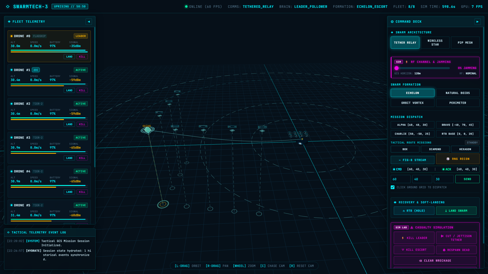

# SwarmTech_v3: UpRising

<p align="center">
  <strong>Autonomous Drone Swarm Simulator & Hardware-Accelerated 3D WebGL Tactical GCS</strong><br>
  <em>Built on a high-performance 50/50 Architecture across 4 Strict Airgaps: Pure Python Kinematics & GPU-Native Three.js Rendering.</em>
</p>

<p align="center">
  
  
  
  
  
  
</p>

<p align="center">
  
</p>

---

## 1. System Mission & The 4 Airgaps

Previous desktop swarm simulators suffered from frame drops, sluggish UI freezing, and cross-contamination between user interface inputs and physical simulation memory.

**`SwarmTech_v3-Uprising`** solves this by strictly enforcing a **50/50 Architecture** across **4 Explicit Airgaps**:
1. **The Operator Airgap (Tactical GCS Terminal)**: Renders only downlinked telemetry packets (`TELEMETRY_FRAME`). Emits flight intents. Never alters ground truth physics directly.
2. **The Canyon Airgap (Packet Network Link)**: The physical and electromagnetic void between ground station and fleet. Only serialized packets (UDP 9000/9001, MAVLink UDP 14550, or WebSocket JSON) cross this boundary.
3. **The Brain Airgap (Isolated Drone OBC Fleet)**: Each airframe runs an isolated Onboard Computer (OBC) bubble. Drones steer only to authenticated local target buffers, maintaining autonomous failsafes (Doctrine A loiter, automated breakaway dive, RTB soft landing) on comms loss.
4. **The God-View / Sim Airgap (SITL World Simulator & Test Harness)**: Ground truth physics engine running an **ideal Flight Controller (FC) digital twin** (60 FPS kinematics, velocity clamps, yaw slew rate limiting, tilt angle coupling). Strictly separates operator flight commands from simulation fault injections.

---

## 2. Key Capabilities & Technical Features

### Sane 4-Zone Spatial Safety (No "Truck-Sized" Bubbles)
True-to-scale physics with metric dimensions:
* **Airframe Scale**: $R_{\text{body}} = 0.75\text{m}$ (Wingspan $= 1.5\text{m}$).
* **Zone 1 ($d > 8.0\text{m}$)**: Nominal flight toward formation slots or waypoints. Zero repulsion.
* **Zone 2 ($3.5\text{m} < d \le 8.0\text{m}$)**: Smooth linear separation steering effort.
* **Zone 3 ($1.5\text{m} < d \le 3.5\text{m}$)**: **Active Relative-Velocity Damping** brakes incoming momentum and prevents discrete pinball penetration:
  $$\mathbf{a}_{\text{evade}} = \left[ 12.0 + 8.0 \cdot \left(\frac{3.5 - d_{ij}}{3.5 - 1.5}\right) \right] \hat{\mathbf{n}}_{ij} - 1.5 (\mathbf{v}_i - \mathbf{v}_j)_{\parallel}$$
* **Zone 4 ($d \le 1.5\text{m}$)**: Prop clash threshold. Motors cut (`crashed = True`), airframe enters ballistic gravity drop ($g = -9.81\text{m/s}^2$).

### Ideal Flight Controller (FC) Kinematic Digital Twin
Bypasses the CPU bloat and numerical instability of non-linear blade element aerodynamics in favor of an ideal, deterministic FC twin:
* **Velocity & Acceleration Clamps**: $v_{\text{cruise}} = 12.0\text{ m/s}$, $v_{\text{max}} = 20.0\text{ m/s}$, $a_{\text{max}} = 15.0\text{ m/s}^2$.
* **Attitude Tilt Coupling**: $\tan\theta = a_x/g$, $\tan\phi = a_y/g$, with angular slew rate limit $|\dot{\theta}|, |\dot{\phi}| \le 250^\circ/\text{s}$.
* **Yaw Slew Rate Limiting**: Maximum turning rate $\le 45^\circ/\text{s}$ with arrival deadbands ($0.25\text{m}$).

### Pluggable Guidance Brains (Centralized & Decentralized)
* **`LeaderFollowerBrain`**: Star topology where flagship transmits heartbeats and followers hold staggered formation slots.
* **`GossipConsensusBrain`**: Fully decentralized leaderless P2P mesh network. Target waypoints propagate via multi-hop gossip echo waves until a $75\%$ quorum consensus barrier is achieved, prompting simultaneous swarm maneuver.
* Hot-swappable at runtime with zero physics hitching.

### Discrete Waypoint Mission Queue (TKT-28)
* Lightweight discrete 3D/4D waypoint lists (`[x, y, z, loiter_s]`) deployed via atomic `UPLOAD_MISSION_ROUTE` packets.
* Presets: `BOX_PATROL`, `DIAMOND_SURVEY`, `HEXAGON_SWEEP`.
* Fleet OBC stores waypoint queues and advances upon reaching acceptance radius $R_{\text{accept}} = 2.5\text{m}$.
* Three.js renders dynamic connected 3D neon polyline ribbons.

### Tactical RNG Touch-and-Go Reconnaissance (TKT-29)
* **Deterministic Handshake**: Fleet emits `target_reached = True` (MAVLink `MISSION_ITEM_REACHED`) ping upon arrival.
* **Telemetry-Gated Dwell**: GCS executes 2.0s tactical sensor dwell, then rolls high-variance SAFE coordinates ($\Delta d \ge 15.0\text{m}$) outside the 3m tether cylinder.
* **Uplink Failure Hold**: GCS freezes beacon and halts re-rolls when link drops.

### Tri-Mode Comms Architecture & Contested RF Simulation (TKT-17)
* **`TETHERED_RELAY`**: Hardline umbilical to Drone #0; immune to GCS uplink jamming; 3m clearance cylinder enforced.
* **`LEADER_FOLLOWER`**: Untethered wireless star; subject to $120\text{m}$ GCS radio range and EW jamming.
* **`GOSSIP_CONSENSUS`**: Untethered decentralized P2P mesh; multi-hop gossip wave with quorum consensus.
* **RF Physics**: Quadratic path loss $P_{\text{loss}}(d) = \gamma + (1-\gamma) \cdot 0.25 \cdot (d/R_{\text{max}})^2$ with operator EW jamming slider ($\gamma \in [0.0, 0.5]$).

### Catenary Tether Dynamics, Breakaway Dive & Succession (TKT-16 / TKT-27)
* Real-time 16-point catenary curve calculating gravitational sag from anchor $(0, 0, 1.5\text{m})$.
* **Altitude-Gated Breakaway**: On cable snip, Drone #0 performs an altitude-gated breakaway dive ($\Delta Z \ge 4.0\text{m}$, lateral peel $6.0\text{ m/s}$), jettisons umbilical over 1.5s GPU dissolve, and climbs smoothly to rejoin wing escort slot with zero prop clashes.
* **Fleet Doctrine A**: Promoted 2IC holds 30s defensive loiter before executing automated `SWARM_RTB`.

### 2-Stage Soft Landing & Coordinated ATC Pad Allocation (TKT-19)
* **Stage 1 (`OVERHEAD_MARSHAL`)**: Sentry ring at $Z = 25\text{m}$, $R = 20\text{m}$ outside the 3m tether cylinder.
* **Stage 2 (`AUTHORIZED_LAND`)**: ATC pad allocation with 2.0s clearance stagger intervals, 2-stage vertical deceleration ($-1.5\text{ m/s} \rightarrow -0.5\text{ m/s}$), and touchdown disarm (0 RPM, ground-locked).

### GPU-Native WebGL Tactical GCS & Dual-Target C2 (TKT-26)
* **Commanded Target (Hollow Cyan Diamond)**: Tracks operator mouse clicks, waypoint presets, and continuous Fig-8 patrol route in real time.
* **Swarm Acknowledged Target (Solid Emerald Diamond)**: Tracks actual waypoint confirmed in active OBC memory.
* **Visual Divergence**: When uplink is severed or jammed, Commanded marker moves away while Swarm Acknowledged marker remains frozen at the Doctrine A loiter point.
* **HUD Features**: 3D billboard tactical ID badges, dynamic rotor spin and color changes, click-to-focus chase cam, and HTML5 Gamepad API override (RadioMaster / EdgeTX).

### UDP Network Bridge & MAVLink Loopback
* **Port 9000 (TX)**: Non-blocking UDP broadcast of swarm telemetry JSON array.
* **Port 9001 (RX)**: External UDP command listener.
* **Port 14550 (MAVLink v2 Loopback)**: Emits binary MAVLink `HEARTBEAT` and `GLOBAL_POSITION_INT` messages with GPS projection for integration with QGroundControl and SITL tools.

---

## 3. Quick Start & Execution

### Prerequisites
* Windows 10/11
* Python 3.12 (Anaconda / Miniconda environment recommended)

### One-Click Startup (PowerShell)
```powershell
# Run the automated headless smoke test (exits code 0 in ~0.15s)
.\run.ps1 -SmokeTest

# Launch simulation backend and auto-open WebGL GCS in default browser
.\run.ps1
```

### Direct Python Invocation
```powershell
# Interactive mode (opens browser to http://127.0.0.1:8080)
python run.py

# Custom swarm size or port
python run.py --count 12 --port 8080

# Headless verification mode
python run.py --smoke-test
```

---

## 4. Automated Test Suite

Run the full automated unit test suite covering kinematics, 4-zone safety, tether dynamics, pluggable brains, mission routes, RNG recon, and network bridges:

```powershell
python -m unittest discover tests
# or via launcher:
.\run.ps1 -UnitTest
```

```text
Ran 96 tests in 0.512s

OK
```

---

## 5. Repository Topology

```
SwarmTech_v3-Uprising/
├── README.md                       # Master documentation & technical guide
├── AGENTS.md                       # Architectural landmark & design invariant guide
├── SWARM_UPRISING_SPEC.md          # Complete mathematical & architectural specification
├── kanban.md                       # Strict single-WIP project lifecycle board
├── kanban_scope.md                 # Deep technical scoping for candidate tickets
├── kanban_archive.md               # Settled milestone history
├── run.py                          # Unified backend launcher, browser opener & smoke test runner
├── run.ps1                         # Zero-config PowerShell launcher with DLL path injection
├── backend/                        # Python Simulation & Networking Backend
│   ├── __init__.py                 # Self-healing Conda DLL and sys.path bootstrap
│   ├── sim_core.py                 # Vectorized 60 FPS boids, 4-zone safety, tether, LKP
│   ├── mavlink_bridge.py           # UDP ports 9000, 9001, and 14550 MAVLink loopback
│   ├── web_server.py               # aiohttp static web server & 60 FPS WebSocket streamer
│   └── brains/                     # Pluggable Guidance Brain Modules
│       ├── __init__.py             # Brain registry and factory
│       ├── base.py                 # BaseBrain plugin interface
│       ├── leader_follower.py      # Tethered leader-follower with LKP recovery
│       └── gossip_consensus.py     # Decentralized P2P mesh with quorum consensus
├── frontend/                       # Three.js WebGL Tactical GCS
│   ├── index.html                  # GCS entry point & layout
│   ├── css/
│   │   └── style.css               # Cyberpunk dark navy (#061019) & neon HUD styling
│   └── js/
│       ├── app.js                  # Three.js 3D scene, quadcopters, drop-lines, camera
│       ├── hud.js                  # Telemetry cards, mission dispatch, casualty lab
│       └── ws_client.js            # Duplex WebSocket state synchronization client
└── tests/                          # Automated unit test suite (96 tests)
    ├── __init__.py
    ├── test_sim_core.py            # Physics, 4-zone avoidance, tether snap, LKP tests
    ├── test_brains.py              # Brain plugins, P2P gossip wave, quorum tests
    ├── test_mavlink_bridge.py      # UDP packet dispatch and MAVLink parsing tests
    ├── test_web_server.py          # WebSocket streaming and static asset serving tests
    ├── test_succession_deconfliction.py  # Autonomic succession and peel-off corridors
    ├── test_tether_failsafes.py    # Altitude-gated breakaway dive and jettison
    ├── test_rtb_landing.py         # 2-stage soft landing and ATC pad allocation
    ├── test_tri_mode_rf.py         # Tri-mode comms, EW jamming, and path loss
    ├── test_gossip_formations.py   # Decentralized geometric swarm patterns
    ├── test_c2_decoupling.py       # Ground truth vs autopilot decoupling
    ├── test_mission_routes.py      # Discrete waypoint mission queues (TKT-28)
    └── test_rng_recon.py           # Tactical RNG touch-and-go generator (TKT-29)
```

---

## 6. Controls Reference

| Control | Action |
| :--- | :--- |
| **Left-Click + Drag** | Orbit camera around tactical space |
| **Right-Click + Drag** | Pan tactical camera |
| **Scroll Wheel** | Zoom in / out |
| **Left-Click on Ground** | Dispatch target waypoint to swarm |
| **`[C]` Key** | Toggle Chase Cam mode |
| **`[R]` Key** | Reset camera to tactical overview |

---

## 7. License

Distributed under the MIT License. Built for autonomous multi-agent robotics.
