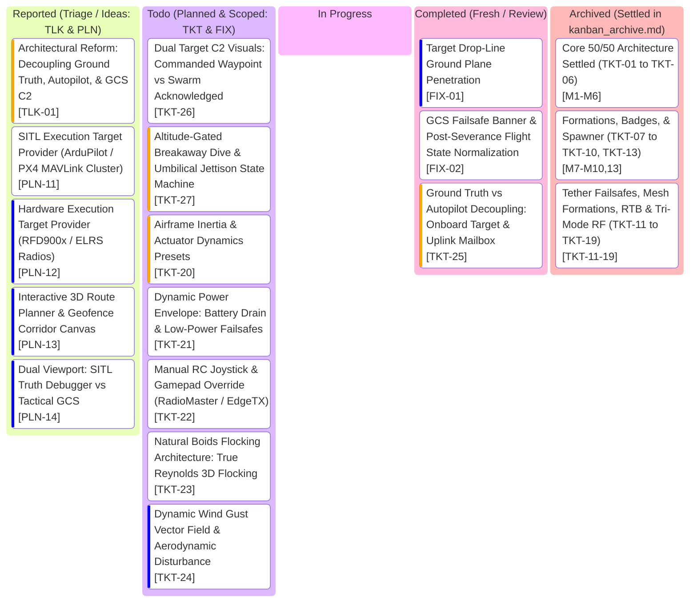

# SwarmTech3_UpRising: Project Kanban Board

> **Tactical GCS Workflow & Task Lifecycle** | **Palette: Dark Navy (#061019) & Neon Cyan (#00F0FF)**  
> *50/50 Architecture: Pure Python Kinematics & GPU-Native Three.js Rendering*

---

## 1. Visual Task Lifecycle Board

---

## 2. Bug Log & Engineering Specs Table

> *Note: Detailed scoping and acceptance criteria are maintained across the 3-document architecture:*
> * **[kanban.md](kanban.md)**: Active working board & current specs table.
> * **[kanban_scope.md](kanban_scope.md)**: Deep technical architecture & planned implementation notes.
> * **[kanban_archive.md](kanban_archive.md)**: Settled milestones (`[TKT-01]` to `[TKT-19]`) and historical decisions (`[PLN-01]` to `[PLN-04]`).

| Ticket ID | Feature / Component | Priority | Status | Acceptance Criteria | Test Command | Root Cause & Engineering Solution |
| :--- | :--- | :--- | :--- | :--- | :--- | :--- |
| **TLK-01** | Architectural Reform: Ground Truth vs Drone Autopilot vs GCS C2 (`sim_core.py`, `brains/`, `web_server.py`, `hud.js`) | **High** | **Reported** | - Master architectural reform integrating `something.md` into SwarmTech3. - Formally decouples the 3 entities:   1. **Ground Truth Simulation (`sim_core.py`)**: Physical universe (true 60 FPS kinematics, collisions, cable severance, true RF propagation).   2. **Onboard Drone Autopilots (`brains/`, `Drone`)**: Isolated firmware logic. Drones steer only to onboard `acknowledged_target` received via uplink packets. Executes local autonomous failsafes when comms drop.   3. **GCS C2 Viewport (`app.js`, `hud.js`)**: Operator terminal. Renders only telemetry downlinked to GCS. Uplinks commanded waypoints. - Decomposes into: `TKT-25`, `TKT-26`, `TKT-27`, `FIX-01`, `FIX-02`. | Architectural Review | Leaks between GCS and physics caused 2IC to chase patrol targets through a severed tether and GCS to accept god-mode overrides. Solution: Implement packet-bound message contracts between Ground Truth, Drone Onboard Memory, and GCS C2. |
| **FIX-01** | Target Drop-Line Ground Plane Penetration (`app.js`) | **Low** | **Completed** | - Target beacon vertical laser beam / drop-line dynamically terminates strictly at ground plane ($Z = 0.0\text{m}$). - Eliminates visual defect where fixed $60\text{m}$ cylinder extends $40\text{m}$ below the floor into negative Z space. - Ground pulse ring remains pinned at $Z = 0.05\text{m}$. | Visual Viewport Check | `createTargetBeacon()` in `app.js` instantiated a static 60m cylinder centered at $Z - 30\text{m}$. When target altitude is $\sim 20\text{m}$, the bottom penetrates to $Z = -40\text{m}$. Solution: Dynamically adjust the drop-line geometry / scale from $(X, Y, Z_{\text{target}})$ to $(X, Y, 0.0)$ on each frame. |
| **FIX-02** | GCS Failsafe Banner & Post-Severance Flight State Normalization (`hud.js`, `sim_core.py`) | **Medium** | **Completed** | - Fix fallthrough `else` in `hud.js` displaying `"UPLINK SEVERED: RETURNING TO BASE"` after operator cancels RTB. - Telemetry reflects actual state: `"UNTETHERED CRUISE (MISSION RESUMED)"` when operator overrides. - When operator commands mission resume after tether snap, formally normalize `comms_mode` to `LEADER_FOLLOWER` or flag autonomous untethered flight. | `.\run.ps1 -UnitTest` | Fallthrough `else` in `hud.js:364` unconditionally rendered the RTB banner when `tether.severed` was true and loiter timer was 0, ignoring `swarm_rtb_active = False`. Solution: Add explicit state checks for `CRUISE` / `OVERHEAD_HOLD` and update banner accordingly. |
| **TKT-25** | Ground Truth vs Autopilot Decoupling: Onboard Target & Uplink Mailbox (`sim_core.py`, `brains/`, `web_server.py`) | **High** | **Completed** | - Move `patrol_active` loop out of `sim_core.step()` into GCS C2 layer. - Each `Drone` airframe maintains an internal `acknowledged_target` buffer in memory. - Uplink packet ingestion: GCS target dispatches pass through simulated radio/tether channel. If tether is severed or RF distance $>120\text{m}$, packets are dropped. - Drones steer strictly to `acknowledged_target`. Under Doctrine A tether severance, swarm loiters over last known acknowledged target without chasing dead-wire GCS patrol updates. - 0 prop clashes across all formations. | `.\run.ps1 -UnitTest` | Physics step directly injected target updates into drones regardless of link status. Solution: Establish an isolated onboard target buffer per drone updated strictly via survived uplink packets. |
| **TKT-26** | Dual Target C2 Visuals: Commanded Waypoint vs Swarm Acknowledged (`app.js`, `hud.js`) | **Medium** | **Todo** | - Three.js viewport renders 2 distinct 3D target markers:   1. **Commanded Target** (Hollow cyan diamond / crosshair): Follows operator clicks and continuous Fig-8 patrol route in real time.   2. **Swarm Acknowledged Target** (Solid emerald diamond with laser drop-line): Tracks the actual waypoint loaded in the active leader/gossip consensus memory. - Visual divergence: When uplink is severed or jammed, Commanded marker moves away while Swarm Acknowledged marker remains frozen at Doctrine A loiter point. - In Gossip mode, Swarm marker visibly transitions only after gossip quorum is achieved. | Visual Viewport Check | Operators could not distinguish between what GCS was commanding vs what the swarm actually received. Solution: Implement dual-marker rendering in `app.js` and sync via WebSocket telemetry snapshot. |
| **TKT-27** | Altitude-Gated Breakaway Dive & Umbilical Jettison State Machine (`sim_core.py`, `leader_follower.py`, `app.js`) | **High** | **Todo** | - Replace $1.5\text{s}$ blind timer with physical geometric clearance gate: $\Delta Z_{\text{dive}} \ge 4.0\text{m}$ below formation plane and lateral displacement $\Delta R_{\perp} \ge 3.0\text{m}$. - Strict safety floor clamp: $Z_{\text{dive}} = \max(3.0\text{m}, Z_{\text{swarm}} - 4.5\text{m})$ preventing terrain impact. - 6.0s safety watchdog timer fallback. - Jettison sequence: Physical clearance gate $\rightarrow$ umbilical detaches and dissolves over 1.5s $\rightarrow$ clean unencumbered Drone 0 climbs to rejoin wing escort slot. - Zero prop-clashes or wake collisions during succession. | `.\run.ps1 -UnitTest` | 1.5s timer was too brief to overcome airframe inertia, making the dive imperceptible. Solution: Gate state transitions on physical $(Z, R_{\perp})$ clearance thresholds before initiating cable jettison and wing rejoin. |
| **TKT-20** | Airframe Inertia, Actuator Dynamics & Tuning Presets (`sim_core.py`, `app.js`, `hud.js`) | **High** | **Todo** | - Replace point-mass instantaneous kinematics with 1st-order motor response lag ($\dot{\mathbf{a}} = \frac{\mathbf{a}_{\text{target}} - \mathbf{a}}{\tau}$) with $\tau \in [0.04\text{s}, 0.16\text{s}]$. - Attitude tilt-thrust acceleration coupling: $\tan(\theta) = a_x / g$, $\tan(\phi) = a_y / g$, with angular slew rate limit ($|\dot{\theta}|, |\dot{\phi}| \le 250^\circ/\text{s}$) and maximum tilt clamp $\theta_{\text{max}}$. - Vectorized quadratic aerodynamic drag $\mathbf{a}_{\text{drag}} = -k_d \|\mathbf{v}\|\mathbf{v}$ providing realistic braking drift. - 3 Airframe Tuning Presets: `LIGHTWEIGHT_RACER` ($1.2\text{kg}$, $\tau=0.04\text{s}$, $\theta_{\text{max}}=55^\circ$), `TACTICAL_RECON` ($2.5\text{kg}$, $\tau=0.08\text{s}$, $\theta_{\text{max}}=35^\circ$), `HEAVY_PAYLOAD` ($6.0\text{kg}$, $\tau=0.16\text{s}$, $\theta_{\text{max}}=20^\circ$). - GCS UI: 3-way preset selector toggle in Command Deck (`SET_AIRFRAME_PRESET`), dynamic telemetry snapshot with `airframe_preset`, and realistic 3D mesh attitude tilt in Three.js (`app.js`). | `.\run.ps1 -UnitTest` | Settles PLN-08 and PLN-09. Point-mass kinematics yields instantaneous velocity vector jumps with zero aerodynamic drift or physical inertia. Solution: Implement 1st-order motor spool filter and coupled tilt-thrust equations in `sim_core.py` 60 FPS update loop, integrate quadratic drag vector, provide GCS preset profiles, and mirror true pitch/roll angles to Three.js quadcopter meshes. |
| **TKT-24** | Dynamic Wind Gust Vector Field & Aerodynamic Disturbance (`sim_core.py`, `app.js`, `hud.js`) | **Low** | **Todo** | - 3D Dryden / Perlin wind vector field: $\mathbf{v}_{\text{wind}}(\mathbf{x}, t) = \mathbf{v}_{\text{base}} + \mathbf{v}_{\text{gust}}(t)$. - Base wind speed configurable via GCS slider ($0\text{--}15\text{ m/s}$) and wind heading ($0\text{--}360^\circ$). - Aerodynamic disturbance force applied to airframes: $\mathbf{F}_{\text{wind}} = \frac{1}{2} \rho C_d A \|\mathbf{v}_{\text{rel}}\| \mathbf{v}_{\text{rel}}$ where $\mathbf{v}_{\text{rel}} = \mathbf{v}_{\text{wind}} - \mathbf{v}_{\text{drone}}$. - Autopilot crab angle: Drones automatically lean into crosswinds to hold precision formation slots. - GCS UI: Cyberpunk compass rose HUD widget with live wind vector arrow, m/s readout, and gust intensity indicator. | `.\run.ps1 -UnitTest` | Settles idea1. Airframe simulation operates in ideal dead-calm air. Solution: Vectorize dynamic wind field acceleration in `sim_core.py`, calculate aerodynamic relative velocity drag, model crosswind drift, and expose operator wind controls across WebSocket and HUD. |
| **TKT-23** | Natural Boids Flocking Architecture: True Reynolds 3D Flocking (`brains/`, `sim_core.py`) | **Medium** | **Todo** | - Replace rigid Cartesian grid world offsets in `NATURAL_FLOCK` with true Reynolds 3D boid flocking forces:   1. Separation: $\mathbf{a}_{\text{sep}} = \sum_{j \ne i} \frac{\mathbf{r}_i - \mathbf{r}_j}{\|\mathbf{r}_i - \mathbf{r}_j\|^2}$ for $d < 4.0\text{m}$.   2. Alignment: $\mathbf{a}_{\text{align}} = \frac{1}{|N_i|} \sum_{j \in N_i} (\mathbf{v}_j - \mathbf{v}_i)$ for $d < 12.0\text{m}$.   3. Cohesion: $\mathbf{a}_{\text{coh}} = \frac{\mathbf{r}_{\text{centroid}} - \mathbf{r}_i}{\|\mathbf{r}_{\text{centroid}} - \mathbf{r}_i\|}$ for $d < 16.0\text{m}$.   4. Centroid Goal Pull: Swarm centroid tracks consensus target or flagship position with bounded arrival velocity. - Boundary safety: Enforces 3m tether clearance cylinder and altitude floor ($Z \ge 10.0\text{m}$). - Dynamic organic flocking: Swarm dynamically compresses through corridors, streams around obstacles, and banks organically through turns with zero prop clashes ($d > 1.5\text{m}$). - Fully compatible with both `LeaderFollowerBrain` and `GossipConsensusBrain`. | `.\run.ps1 -UnitTest` | Settles PLN-05. Previous `NATURAL_FLOCK` relied on fixed Cartesian $(X, Y)$ world offsets, preventing organic turning or dynamic flocking. Solution: Implement vectorized 3D Reynolds acceleration weights in both brains combined with Zone 3 momentum damping, enabling true murmuration behavior around mission waypoints. |
| **TKT-21** | Dynamic Power Envelope: Battery Drain Curves & Low-Power Failsafes (`sim_core.py`, `web_server.py`, `hud.js`) | **Medium** | **Todo** | - Non-linear LiPo discharge model: Instantaneous power $P(t) = P_{\text{avionics}} + P_{\text{hover}} \left(\frac{\|\mathbf{T}\|}{mg}\right)^{1.5} + P_{\text{aero}}(\mathbf{v})$. - Tether power asymmetry: In `TETHERED_RELAY`, Drone #0 is powered continuously via umbilical ($100\%$ locked); on tether sever/jettison, seamlessly transfers to internal battery backup. Escorts consume internal battery. - 2-Stage Low-Power Failsafe State Machine:   1. Advisory Warning ($\le 25\%$): Amber HUD alert banner, card tag `LOW BATT (25%)`, automated RTB prompt.   2. Critical Failsafe ($\le 10\%$): Red emergency alert, auto-engages coordinated soft-landing (`LAND_DRONE` or priority ATC pad reservation) to prevent unpowered drop.   3. Depletion ($0\%$): Motors cut, rotors stop (0 RPM), drone transitions to ballistic casualty. - GCS UI: Live battery progress bars on cards (Green $>50\%$, Amber $25\text{--}50\%$, Red pulse $<25\%$), voltage ($V$) and instantaneous wattage ($W$) telemetry displays. | `.\run.ps1 -UnitTest` | Settles PLN-06. Battery was a static 100% telemetry display without power curves or failure states. Solution: Implement thrust-dependent power integration and LiPo voltage drop in `sim_core.py`, model tether power bus vs internal battery switching, trigger automated recovery at 25% and emergency soft-landing at 10%, and update HUD cards with dynamic color-coded battery meters. |
| **TKT-22** | Manual RC Joystick & Gamepad Override (`hud.js`, `web_server.py`, `sim_core.py`) | **Medium** | **Todo** | - Ingest USB-C HID RC controllers (RadioMaster Pocket CC2500, TX16S in EdgeTX joystick mode) and standard gamepads (Xbox, PlayStation) via HTML5 Gamepad API in `frontend/js/hud.js`. - 4-axis flight stick mapping: Left Stick (Throttle $\pm v_z$ + Yaw rate $\dot{\psi}$), Right Stick (Pitch $+X$ velocity + Roll $+Y$ strafe velocity). - Deadband threshold ($0.08$) and exponential curve ($\text{expo} = 0.3$) for precision stick feel. - Mode toggle: `MANUAL_OVERRIDE` command sent over `/ws` to pilot Flagship (Drone #0) or targeted drone. - Escort swarm tracks formation dynamically around the pilot-controlled flagship during manual flight. - Failsafe timeout: Reverts to autonomous hover/loiter if gamepad signal is lost for $>1.0\text{s}$. - GCS UI: Gamepad connection status badge (`🎮 RADIOMASTER CONNECTED`), live stick deflection crosshair overlay in HUD. | `.\run.ps1 -UnitTest` | Settles PLN-07. Operators lacked direct pilot stick control over flight trajectories. Solution: Implement browser-native Gamepad API loop in `hud.js` dispatching 60 Hz normalized axis packets `{ cmd: 'MANUAL_CONTROL', throttle, yaw, pitch, roll }`, with `sim_core.py` applying direct velocity-demand control to the active craft while maintaining autonomous formation guidance for escorts. |
| **PLN-14** | Dual Viewport: SITL Truth Debugger vs Tactical GCS Digital Twin (`app.js`) | **Low** | **Reported** | - Optional split-screen / toggleable "God-View Truth" display for simulation analysis. - Renders true physics airframe coordinates alongside GCS telemetry downlink positions, visualizing packet drop lag, RF dead zones, and ghost trajectories. | Visual Viewport Check | Provides developers and researchers immediate visual debugging of network latency and telemetry loss. |
| **PLN-11** | SITL Execution Target Provider (ArduPilot / PX4 MAVLink Cluster) (`mavlink_bridge.py`, `sim_core.py`) | **Medium** | **Reported** | - Multi-instance SITL bridge via MAVLink UDP (port 14550), swapping `sim_core.py` for real autopilot firmware running in simulated GPS environments. - Groundwork for SwarmTech4 operational execution targets (`something.md`). | Architecture Review | SwarmTech3 runs in-memory kinematics. SwarmTech4 introduces hot-swappable SITL execution targets. |
| **PLN-12** | Hardware Execution Target Provider (Real-World Telemetry Radios: RFD900x / ELRS) (`mavlink_bridge.py`) | **Low** | **Reported** | - USB serial radio bridge (RFD900x, Holybro SiK, ExpressLRS) routing live MAVLink packets from physical UAVs directly into the 3D WebGL tactical viewport. - SwarmTech4 hardware transition milestone. | Architecture Review | Prepares SwarmTech C2 core for physical field operations with real carbon-fiber airframes. |
| **PLN-13** | Interactive 3D Route Planner & Geofence Corridor Canvas (`app.js`, `hud.js`) | **Low** | **Reported** | - Interactive 3D polyline corridor drawing with altitude shelves, Dubins path turn smoothing, automated survey grids, and cylindrical threat keep-out zones (`something.md` Pillar 1). | Manual GCS Test | Adds mission planning canvas on top of real-time manual target dispatch. |

---

## 3. Strict Kanban Governance Rules
1. **WIP = 1**: At most one active ticket in `In Progress` at any time.
2. **Verification Gate (Code Deliverables Only)**: Code tickets require passing their targeted test module before moving to `Completed`. Non-code changes (documentation, board theme/layout, comments) require zero tests.
3. **User Sign-Off**: Cards in `Completed` remain for user testing and review until explicitly approved for archival.
4. **Git Hygiene**: Governed by `git-workflow-guard`. Never commit standalone housekeeping churn; bundle verified code, targeted tests, and board transitions into single atomic feature commits.

### Project Ticket Prefix Standard
* **`TKT-xx`** / **`FIX-xx`** / **`BUG-xx`** *(For Doing)*: Actionable, scoped work ready for active coding.
* **`PLN-xx`** *(Future Candidate / Roadmap)*: A new feature or change under consideration, but **not yet committed** to implementation.
* **`TLK-xx`** *(Architectural Reform / Discussion)*: Major architectural shifts requiring deep planning and discussion. Activations typically spawn multiple `TKT` or `PLN` tickets.

> **Execution Order Note**: Ticket IDs (numbers) are persistent identifiers and do **NOT** dictate chronological order of completion. Execution follows architectural priorities and developer direction.

---

## 4. Recommended Implementation Sequence (Pinned Roadmap)

### Phase 0: Immediate Viewport Polish & Telemetry Fixes (Quick Wins)
* **`[FIX-01]` Target Drop-Line Ground Plane Penetration** *(Low Priority - Quick Win)*:
  - Dynamically clamp the vertical drop-line geometry in Three.js strictly from $(X, Y, Z_{\text{target}})$ to $(X, Y, 0.0\text{m})$, eliminating the static $60\text{m}$ cylinder penetration into negative Z space.
* **`[FIX-02]` GCS Failsafe Banner & Post-Severance Flight State Normalization** *(Medium Priority)*:
  - Fix fallthrough `else` in `frontend/js/hud.js` displaying `"UPLINK SEVERED: RETURNING TO BASE"` after operator cancels RTB; formally normalize untethered flight state (`"UNTETHERED CRUISE (MISSION RESUMED)"`).

### Phase 1: The 3-Entity Architectural Reform (TLK-01 / something.md Integration)
*Core Mission: Strictly decouple Ground Truth Simulation (System 1), Onboard Drone Autopilots (System 2), and GCS C2 (System 3) to eliminate all "dead-wire" command leakage.*
* **`[TKT-25]` Ground Truth vs Autopilot Decoupling: Onboard Target & Uplink Mailbox** *(High Priority - Core Architecture)*:
  - Remove `patrol_active` from the physics tick (`sim_core.step()`); move route generation to GCS C2.
  - Equip each `Drone` with an isolated internal `acknowledged_target` buffer.
  - Implement uplink packet gating: GCS target dispatches pass through the simulated radio/tether channel; packets drop if tether is severed or RF distance $>120\text{m}$.
  - Drones steer strictly to local acknowledged target. Under Doctrine A tether severance, the swarm holds loiter on its last order rather than chasing dead-wire GCS patrol updates.
* **`[TKT-26]` Dual Target C2 Visuals: Commanded Waypoint vs Swarm Acknowledged** *(Medium Priority - Situational Awareness)*:
  - Three.js renders 2 distinct 3D target markers:
    1. **Commanded Target** (Hollow cyan diamond / crosshair): Real-time operator clicks and GCS auto-patrol path.
    2. **Swarm Acknowledged Target** (Solid emerald diamond with laser drop-line): The actual coordinate loaded in the active leader/gossip consensus memory.
  - Visual divergence immediately signals uplink loss: Commanded marker moves away while Swarm Acknowledged marker remains anchored at the Doctrine A loiter point.
* **`[TKT-27]` Altitude-Gated Breakaway Dive & Umbilical Jettison State Machine** *(High Priority - Physical Realism)*:
  - Replace the $1.5\text{s}$ blind timer with a physical geometric clearance envelope: $\Delta Z_{\text{dive}} \ge 4.0\text{m}$ below formation plane and lateral displacement $\Delta R_{\perp} \ge 3.0\text{m}$ (with $6.0\text{s}$ safety watchdog).
  - Umbilical jettison drop and dissolve animation extended to 1.5s for clear visual readability.
  - Clean unencumbered Drone 0 climbs smoothly back into its assigned escort wing slot with zero prop clashes.

### Phase 2: Flight Dynamics & Environmental Physics
*Core Mission: Replace instantaneous point-mass velocity jumps with realistic airframe inertia, aerodynamics, and wind forces.*
* **`[TKT-20]` Airframe Inertia, Actuator Dynamics & Tuning Presets** *(High Priority - Absorbs PLN-08 & PLN-09)*:
  - 1st-order motor spool response filter ($\tau \in [0.04\text{s}, 0.16\text{s}]$), attitude tilt acceleration coupling with angular slew rate limit ($\le 250^\circ/\text{s}$), and quadratic aerodynamic drag.
  - GCS tuning presets: `LIGHTWEIGHT_RACER`, `TACTICAL_RECON`, `HEAVY_PAYLOAD`.
* **`[TKT-24]` Dynamic Wind Gust Vector Field & Aerodynamic Disturbance** *(Low Priority - Absorbs idea1 / PLN-10)*:
  - 3D Dryden/Perlin wind gust simulation, aerodynamic crosswind drift, autopilot crab angles, and GCS compass rose wind HUD widget.
* **`[TKT-23]` Natural Boids Flocking Architecture: True Reynolds 3D Flocking** *(Medium Priority - Absorbs PLN-05)*:
  - True Reynolds 3D boid rules (separation, velocity alignment, centroid cohesion) with dynamic goal attraction, replacing rigid Cartesian world offsets.

### Phase 3: Tactical Avionics & Operator Control
*Core Mission: Real-world battery management, power switching, and human-in-the-loop manual joystick control.*
* **`[TKT-21]` Dynamic Power Envelope: Battery Drain Curves & Low-Power Failsafes** *(Medium Priority - Absorbs PLN-06)*:
  - Thrust-dependent LiPo discharge curves, tether continuous ground power vs internal battery switching upon severance, 25% automated RTB advisory, and 10% critical emergency soft-landing.
* **`[TKT-22]` Manual RC Joystick & Gamepad Override (RadioMaster / EdgeTX)** *(Medium Priority - Absorbs PLN-07)*:
  - Browser HTML5 Gamepad API loop (RadioMaster Pocket, EdgeTX, Xbox/PlayStation), 4-axis flight stick mapping with deadband/expo, flagship stick override with dynamic escort tracking.

### Phase 4: Operational Readiness & Telemetry Bridge (Absorbed into SwarmTech3)
*Core Mission: Swap the in-memory simulation engine for real-world SITL firmware clusters and physical UAV radios as envisioned in something.md.*
* **`[PLN-14]` Dual Viewport Mode: SITL Truth Debugger vs Tactical GCS Digital Twin**:
  - Independent System 1 "God-View Truth" display for simulation analysis, visualizing packet drop lag, RF dead zones, and ghost trajectories against GCS telemetry.
* **`[PLN-11]` SITL Execution Target Provider (ArduPilot / PX4 MAVLink Cluster via UDP 14550)**:
  - Multi-instance SITL bridge connecting SwarmTech C2 router to real autopilot firmware running in simulated GPS environments.
* **`[PLN-12]` Hardware Execution Target Provider (Real-World Telemetry Radios: RFD900x / ELRS / 4G LTE)**:
  - Serial radio gateway routing live MAVLink telemetry from physical carbon-fiber airframes directly into the 3D WebGL viewport.
* **`[PLN-13]` Interactive 3D Route Planner & Geofence Corridor Canvas**:
  - 3D polyline corridor drawing with altitude shelves, Dubins path turn smoothing, automated survey grids, and cylindrical threat keep-out zones.

