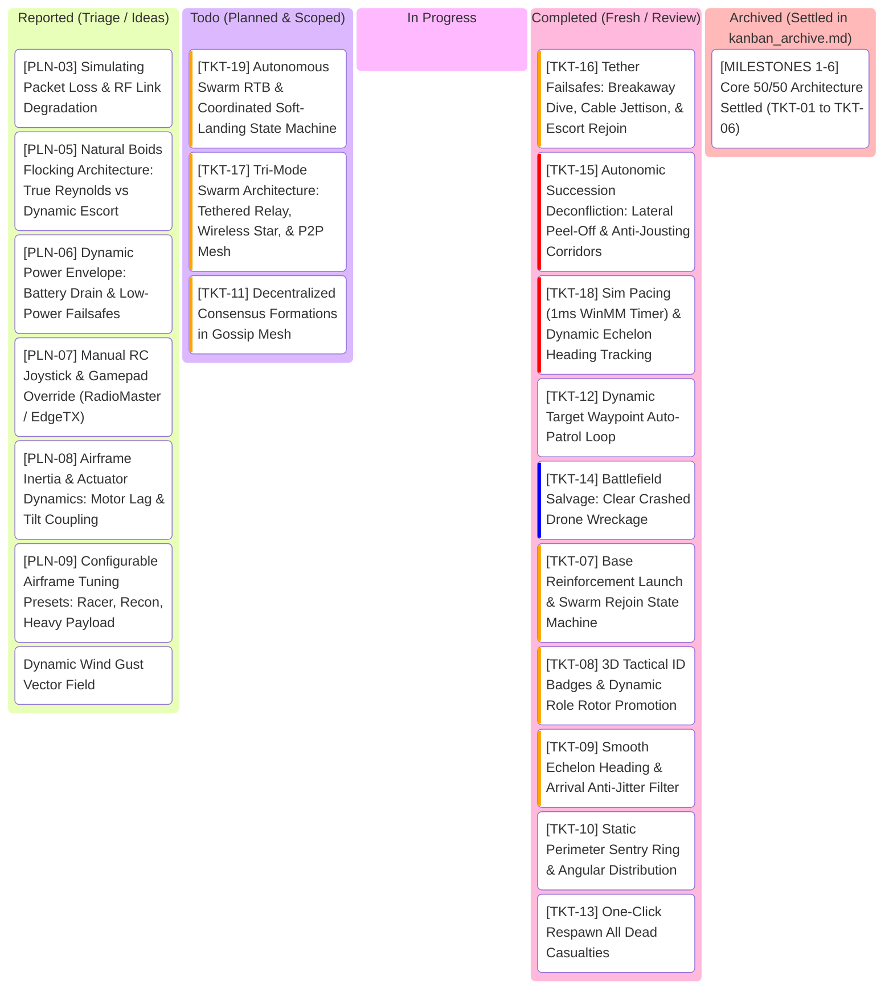

# SwarmTech3_UpRising: Project Kanban Board

---

## 1. Visual Task Lifecycle Board

---

## 2. Bug Log & Engineering Specs Table

> *Note: Archived core milestones (`[TKT-01]` through `[TKT-06]`) and settled architecture decisions (`[PLN-01]`, `[PLN-02]`, `[PLN-04]`) are preserved in [kanban_archive.md](kanban_archive.md).*

| Ticket ID | Feature / Component | Priority | Status | Acceptance Criteria | Test Command | Root Cause & Engineering Solution |
| :--- | :--- | :--- | :--- | :--- | :--- | :--- |
| **TKT-07** | Base Reinforcement Launch & Swarm Rejoin (`sim_core.py`, `hud.js`) | **High** | **Review** | - Reinforcement drones spawn at Base $(0, 0, 0.5)$ with incremental ID ($N_{\text{max}} + 1$). - 3-Phase State Machine: `TAKEOFF` (vertical climb to $Z \ge 20\text{m}$, zero horizontal drift) $\rightarrow$ `EN_ROUTE` (transit toward swarm/slot) $\rightarrow$ `CRUISE` (formation locked). - Rejoining drones seamlessly claim dynamic outer formation slots without disrupting active escorts. - GCS button `[+ REINFORCE SWARM]` dispatches reinforcements. | `.\run.ps1 -UnitTest` | Previously, reviving crashed drones teleported them directly into the sky at $Z=25\text{m}$. In the revised TKT-07 architecture, dead drones remain wreckage on the ground. Implemented `launch_reinforcement()` in `sim_core.py` to spawn reinforcements at base launch pads $(pad_x, pad_y, 0.5)$ outside the 3m tether clearance envelope with sequential IDs ($N_{\text{max}} + 1$). Implemented 3-Phase State Machine: `TAKEOFF` (pure vertical climb to $Z \ge 20\text{m}$ with zero horizontal drift) $\rightarrow$ `EN_ROUTE` (transit to formation slot) $\rightarrow$ `CRUISE` (formation locked). Rebooted drones also ascend via vertical takeoff. Added `LAUNCH_REINFORCEMENT` command in `web_server.py` and `mavlink_bridge.py`, `[+ LAUNCH REINFORCEMENT]` GCS button in `frontend/index.html` and `hud.js`, dynamic WebGL green launch rotor discs and 3D ID badges in `app.js`. 35/35 unit tests pass. |
| **TKT-08** | 3D Tactical ID Badges & Dynamic Role Promotion (`app.js`) | **High** | **Review** | - Floating 3D billboard ID badges (`#X FLAGSHIP`, `#X`, `#X CRASHED`) attached above each drone. - Dynamic rotor disc, core, drop-line, and shadow color updates on autonomic promotion or crash. - Synchronizes 3D visual roles 100% with fleet telemetry cards. | `.\run.ps1 -UnitTest` | Rotor materials were only set once at mesh creation; when Drone #0 died and Drone #1 was promoted, Drone #0 kept yellow rotors on the ground and Drone #1 kept cyan rotors in the sky with no 3D numbers. Fixed by adding dynamic canvas billboard badges and live recoloring of rotors, core, drop-lines, and ground shadows. |
| **TKT-09** | Smooth Echelon Heading & Anti-Jitter Filter (`leader_follower.py`) | **High** | **Review** | - Echelon slots do not flip $180^\circ$ when leader decelerates/overshoots target. - Freeze formation heading when speed $<1.5\text{ m/s}$ or within arrival deadband ($<0.25\text{m}$). - Bounded yaw/heading slew rate ($\le 45^\circ/\text{s}$). | `.\run.ps1 -UnitTest` | At target arrival or when decelerating, leader velocity micro-reversals previously flipped the instantaneous velocity vector by $180^\circ$, causing V-slots to whip violently between front and rear. Fixed in `backend/brains/leader_follower.py` by: (1) Freezing echelon formation heading when speed $< 1.5\text{ m/s}$ or within $8.0\text{m}$ of target; (2) Applying a bounded slew rate filter ($\le 45^\circ/\text{s}$); and (3) Adding a $0.25\text{m}$ arrival deadband with pure velocity damping to eliminate micro-hunting/limit cycles. 30/30 unit tests pass. |
| **TKT-10** | Static Perimeter Sentry Ring (`leader_follower.py`) | **Medium** | **Review** | - `PERIMETER_PATROL` holds static guard positions around target rather than rotating like a carousel. - Drones evenly distributed azimuthally ($\theta_k = \frac{2\pi (k-1)}{N}$) at radius $25\text{m}$. | `.\run.ps1 -UnitTest` | `PERIMETER_PATROL` previously had $\omega = 0.4$, which caused escorts to continuously orbit the target like a carousel. Fixed in `backend/brains/leader_follower.py` and `backend/sim_core.py` by removing the time-dependent rotation term ($\omega = 0.0$), anchoring each escort to a fixed static azimuthal station $\theta_k = \frac{2\pi(k-1)}{N}$ at radius $25.0\text{m}$ around the target. 31/31 unit tests pass. |
| **TKT-11** | Decentralized Formations for Gossip Mesh (`gossip_consensus.py`) | **High** | **Planned** | - Gossip mode supports multi-drone geometries (perimeter shell, distributed grid, virtual centroid slots) instead of clumping into a single point. | `.\run.ps1 -UnitTest` | Currently `GossipConsensusBrain` lacks formation logic; all drones steer directly to the raw active target. Fix: compute virtual consensus anchor and assign decentralized geometric offsets based on peer node IDs. |
| **TKT-12** | Dynamic Target Waypoint Auto-Patrol (`sim_core.py`, `hud.js`) | **Medium** | **Review** | - Toggleable continuous target patrol route (figure-8 / spline circuit with altitude variation $Z=15\text{m}-40\text{m}$). - Allows live observation of swarm pursuit and bank dynamics without manual clicking. | `.\run.ps1 -UnitTest` | Implemented 3D parametric target auto-patrol loop ($X(t), Y(t), Z(t)$ Lemniscate figure-8 with smooth altitude variation $15\text{m}-38\text{m}$) in `backend/sim_core.py`. Exposed `TOGGLE_TARGET_PATROL` across WebSocket, REST (`/api/command`), and UDP port 9001. Added `[∞ AUTO PATROL LOOP]` button in `frontend/index.html` with pulsing emerald `.active-patrol` styling in `frontend/css/style.css` and live telemetry synchronization in `frontend/js/hud.js`. Disengages automatically on manual target dispatch or click. Added unit tests in `tests/test_sim_core.py`, `tests/test_web_server.py`, and `tests/test_mavlink_bridge.py`. 37/37 unit tests pass. |
| **TKT-13** | One-Click Respawn All Casualties (`sim_core.py`, `hud.js`) | **Medium** | **Review** | - GCS button to reboot all destroyed drones simultaneously without resetting living drones or mission clock. | `.\run.ps1 -UnitTest` | Previously, reviving downed casualties required clicking individual reboot buttons on each telemetry card, or triggering `REBOOT_FLEET` which wiped surviving drones, reset sim clock, and snapped back to origin. Implemented `reboot_all_dead()` in `sim_core.py`, exposed `REBOOT_ALL_DEAD` over WebSocket (`web_server.py`) and UDP (`mavlink_bridge.py`), and added dedicated `RESPAWN DEAD` GCS button in `frontend/index.html` & `hud.js`. Revives all crashed casualties in-place while keeping surviving drones and mission clock intact. 32/32 unit tests pass. |
| **TKT-14** | Battlefield Salvage: Clear Crashed Drone Wreckage (`sim_core.py`, `app.js`, `hud.js`) | **Low** | **Review** | - Operator command `CLEAR_WRECKAGE` purges dead/crashed drones from `sim.drones`. - Three.js viewport disposes and removes meshes, rotors, shadows, and 3D badges. - GCS telemetry panel cleans up dead cards and updates fleet counts. - GCS button `[⌫ CLEAR WRECKAGE]` in Casualty Lab. | `.\run.ps1 -UnitTest` | Implemented `clear_crashed_wreckage(self) -> List[int]` in `backend/sim_core.py` to purge all destroyed drones from `self.drones`, clean up peer states in Gossip mode, and elect an active leader if needed. Guaranteed monotonic ID sequence across purges via `_highest_drone_id`. Added `CLEAR_WRECKAGE` / `SALVAGE_WRECKAGE` command handling across WebSocket, REST (`/api/command`), and UDP port 9001. In `frontend/js/app.js`, cleaned up Three.js meshes, drop-lines, shadows, and 3D badges, resetting camera focus if the targeted drone was salvaged. In `frontend/js/hud.js`, added card DOM removal for vanished drones, wired up `[⌫ CLEAR WRECKAGE]` button in Casualty Lab, and styled in `frontend/css/style.css`. Added automated unit tests in `tests/test_sim_core.py`, `tests/test_web_server.py`, and `tests/test_mavlink_bridge.py`. 36/36 unit tests pass. |
| **TKT-15** | Autonomic Succession Deconfliction: Anti-Jousting Corridors (`sim_core.py`, `leader_follower.py`) | **Very High** | **Review** | - Retiring leader and promoted successor must not accelerate along reciprocal paths. - Lateral peel-off corridor applied during role transition ($\mathbf{v}_{\text{peel}} \perp \mathbf{v}_{\text{leader}}$). - Zero Zone 4 prop-clashes when succession triggers at standard $6\text{m}$ slot spacing across Echelon, Boids, and Perimeter formations. | `.\run.ps1 -UnitTest` | Previously, when leader demotion or role swap triggered, the demoted leader reversed toward its new slot while the successor accelerated forward along reciprocal paths, colliding at up to $24\text{ m/s}$ closing speed. Followers also swapped wing sides simultaneously due to index shifting. Implemented: (1) Lateral Peel-Off Corridor in `sim_core.py` and `leader_follower.py`, vectoring the demoted leader away from the successor's approach side with 3D altitude separation ($\Delta Z = -1.5\text{m}$) and forward braking; (2) Promotion acceleration ramp for the new leader; (3) Persistent slot allocation with wing continuity in `LeaderFollowerBrain.assigned_slots` so demoted leader inherits the promoted leader's vacated slot and remaining followers never cross sides; (4) Added test suite in `tests/test_succession_deconfliction.py`. 44/44 unit tests pass. |
| **TKT-16** | Tether Failsafes: Breakaway Dive, Cable Jettison, & Escort Rejoin (`sim_core.py`, `leader_follower.py`, `app.js`, `hud.js`) | **High** | **Review** | - Severance (`CUT_TETHER` or cable clash) marks `tether_severed = True` without killing drone motors. - 4-Phase Recovery State Machine: (1) `EMERGENCY_HANDOFF` (Designated 2IC promoted to Leader, maintaining swarm mission path); (2) `BREAKAWAY_DIVE` (Drone 0 dives $\Delta Z = -3\text{m}$ to $-5\text{m}$ and peels laterally outward at $6\text{ m/s}$ to clear prop wash and prevent trailing line entanglement); (3) `CABLE_JETTISON` (1.5s purge timer, WebGL glowing tether detaches from belly and drops to ground, HUD badge displays amber `[⏏ JETTISONING TETHER]`); (4) `ESCORT_REJOIN` (clean unencumbered Drone 0 climbs to cruise altitude $Z \ge 20\text{m}$ and slides into assigned escort wing slot behind new Leader, or executes autonomous RTB if configured). - Fleet Doctrine A (Staged Failsafe): Promoted 2IC holds swarm in defensive sentry/loiter over last known target for 30s; if GCS uplink is not restored, automatically commands `SWARM_RTB` back to base $(0, 0, 25\text{m})$ for coordinated soft-landing. - GCS UI: Casualty Lab updates to trigger `CUT_TETHER` / `JETTISON_TETHER`, telemetry card displays `[2IC]` indicator and lost-link countdown. | `.\run.ps1 -UnitTest` | Settles PLN-01. Rescoped tether from physical power line to tactical C2 umbilical with emergency breakaway. In multi-drone formation, a severed cable creates a lethal entanglement hazard for trailing craft. Implemented: (1) Dynamic 2IC evaluation in `sim_core.py` (`get_2ic()`) promoting highest-scoring living escort to Leader without mission interruption; (2) 3D Breakaway Dive ($\Delta Z = -4.0\text{m}$, lateral peel $6.0\text{ m/s}$, longitudinal forward braking) and 1.5s umbilical purge timer in `sim_core.py` and `leader_follower.py`; (3) Escort rejoin state transition returning unencumbered Drone 0 to cruise altitude and assigned wing slot with zero prop-clashes; (4) Fleet Doctrine A loiter timer (30s) and automated `SWARM_RTB` back to base $(0, 0, 25\text{m})$; (5) WebGL catenary cable detach, physical drop, and dissolution animation in `app.js`; (6) Glowing `[2IC]` badge, `[⏏ JETTISON]` status tag, top-bar failsafe banner, and event feed logging in `hud.js`, `index.html`, and `style.css`. Added 6 new automated unit tests in `tests/test_tether_failsafes.py`. 50/50 unit tests pass. |
| **TKT-17** | Tri-Mode Swarm Architecture: Tethered Relay, Wireless Star, & P2P Mesh (`sim_core.py`, `app.js`, `hud.js`) | **High** | **Planned** | - 3 distinct Swarm Brain / Comms modes on GCS:   1. `TETHERED_RELAY` (Fiber-optic hardline to Drone 0, followers track relay via radio; tether visible).   2. `LEADER_FOLLOWER` (Untethered wireless RF star; tether hidden).   3. `GOSSIP_CONSENSUS` (Untethered wireless P2P mesh; tether hidden). - In Gossip mode, target clicks inject only to drones within GCS radio range ($\le 120\text{m}$); multi-hop gossip echo wave visibly ripples across mesh until quorum. | `.\run.ps1 -UnitTest` | Settles PLN-02. Wireless modes should not render a phantom ground tether. In Gossip mesh, realistic multi-hop RF demonstration requires injecting target only into nodes within base radio range, making the yellow propagation echo wave visually observable. |
| **TKT-18** | Simulation Tick Pacing (1ms WinMM Timer) & Dynamic Echelon Heading Tracking (`web_server.py`, `leader_follower.py`) | **Very High** | **Review** | - Call `ctypes.windll.winmm.timeBeginPeriod(1)` on Windows on startup (and cleanup `timeEndPeriod(1)`) so `asyncio.sleep` timer resolution is 1ms, eliminating the 15.6ms quantum cliff. Sim runs at locked 60 FPS (1.0x real-time) whether 1 drone or 10 drones are simulated. - Disengage `FREEZE_DIST` heading lock when target is in dynamic motion (`target_patrol_active` or $\|\mathbf{v}_{\text{target}}\| > 0.2\text{m/s}$), allowing Echelon formation to reorient smoothly along pursuit vector during target auto-patrol. - Unit tests verify smooth heading rotation during target motion and timer initialization. | `.\run.ps1 -UnitTest` | At 60 FPS ($16.67\text{ms}$ interval), Windows 15.625ms default sleep quantum causes single-drone loops to oversleep to 31.25ms (32 FPS = 0.5x speed), while 8+ drones reduce remaining sleep below 15.6ms to trigger 1-tick wakeups (64 FPS = 1.0x speed). Implemented `timeBeginPeriod(1)` on Windows startup, precision deadline frame pacing, and disengaged stationary arrival heading freeze when `patrol_active` is True. Added automated unit tests in `tests/test_brains.py` and `tests/test_web_server.py`. 39/39 unit tests pass. |
| **TKT-19** | Autonomous Swarm RTB & Coordinated Soft-Landing State Machine (`sim_core.py`, `leader_follower.py`, `hud.js`, `app.js`) | **High** | **Planned** | - 2-Stage Tactical Recovery Architecture:   1. `OVERHEAD_MARSHAL`: Commanded `RTB (HOLD)` transits fleet back to Base $(0, 0, 25\text{m})$ at cruise speed and settles into a stationary sentry ring at $Z=20\text{m}-25\text{m}$ outside the 3m tether clearance cylinder. Drones hold altitude, remain energized, and are instantly re-taskable.   2. `AUTHORIZED_LAND`: Explicit operator command `[🛬 LAND SWARM]` (or individual `[LAND]`) engages ATC pad reservation and sequential staggered descent ($2.0\text{s}$ clearance intervals to eliminate prop wash down-drafts). - 2-stage vertical deceleration sink rate ($v_z = -1.5\text{ m/s}$ down to $1.0\text{m}$, then gentle $-0.5\text{ m/s}$ to touchdown at ground pad $Z=0.5\text{m}$). - Touchdown disarm: velocity $\mathbf{v}=\mathbf{0}$, motors power down, rotors spin down to 0 RPM, immune to formation pull. - GCS UI: `[🏠 RTB (HOLD)]` and `[🛬 LAND SWARM]` buttons in Mission Dispatch, individual `[LAND]` card toggles, live status badges `OVERHEAD_HOLD` / `LANDED`. | `.\run.ps1 -UnitTest` | Commanded RTB must not blindly touch down immediately, risking collisions on occupied pads or premature disarming when the operator simply wanted the swarm back at home plate. Scope and implement 2-stage tactical recovery: Overhead Marshaling sentry hold followed by operator-authorized sequential ATC pad landing with 2-stage vertical deceleration. |

| **PLN-03** | Simulating Packet Loss & RF Link Degradation (`leader_follower.py`, `gossip_consensus.py`, `hud.js`) | **Low** | **Discussion** | - Model RF packet drop dynamics: uniform drop vs distance-squared path loss vs operator-controlled jamming. - Add live packet loss slider (0%–50%) and link quality telemetry to test LKP failover & gossip quorum resilience. | N/A (Architecture) | Currently packet loss is a fixed 1% uniform drop when enabled. Options: (1) Distance-dependent drop probability $P_{\text{loss}}(d) = 1 - e^{-(d/R_0)^2}$; (2) Operator RF degradation / jamming slider on GCS HUD; (3) Per-drone packet reception rate and signal quality telemetry bars. |
| **PLN-05** | Natural Boids Flocking Architecture: True Reynolds vs Dynamic Escort (`leader_follower.py`, `brains/`) | **Medium** | **Discussion** | - Research & specify true Reynolds boid flocking rules (separation, velocity alignment, centroid cohesion) vs leader-anchored dynamic escort formations. - Address heading-relative slot rotation vs organic autonomous flocking dynamics. | N/A (Architecture) | Currently `NATURAL_FLOCK` in `LeaderFollowerBrain` uses hardcoded Cartesian $(X, Y)$ world offsets, causing the formation to glide rigidly without turning or dynamic flocking. Options: (1) True Reynolds boids flocking vectors with leader as weighted attractant; (2) Heading-oriented dynamic escort envelope. |
| **PLN-06** | Dynamic Power Envelope: Battery Discharge Curves & Low-Power Failsafes (`sim_core.py`, `hud.js`) | **Medium** | **Discussion** | - Model realistic battery discharge as a function of thrust ($P_{\text{hover}} \approx 150\text{W}$, $P_{\text{sprint}} \approx 450\text{W}$, $P_{\text{climb}} \approx 350\text{W}$). - Low-battery warning at 25% battery triggering automated RTB advisory. - Critical threshold at 10% battery triggering automated in-place emergency soft-landing. - Motor and rotor health degradation simulation (damage, thrust loss). | N/A (Architecture) | Currently battery is a static 100% telemetry display without power curves. Scope dynamic Wh/mAh battery state of charge (SoC) integration and automated low-power RTL failsafe behaviors. |
| **PLN-07** | Manual RC Joystick & Gamepad Override (RadioMaster / EdgeTX) (`web_server.py`, `hud.js`, `app.js`) | **Medium** | **Discussion** | - Ingest USB-C HID Gamepad / RC controller inputs (RadioMaster Pocket CC2500, EdgeTX, Xbox/PlayStation controllers) via HTML5 Gamepad API or Python HID. - Real-time Pitch, Roll, Yaw, Throttle manual override of Swarm Leader or selected drone. - Seamless handoff between manual RC pilot override and autonomous swarm formation guidance. | N/A (Architecture) | Allows manual operator pilot-in-the-loop stick control over the flagship or a designated scout drone, with the swarm maintaining autonomous escort formation around the pilot-controlled flagship. |
| **PLN-08** | Airframe Inertia & Actuator Dynamics: Motor Lag & Tilt Coupling (`sim_core.py`, `brains/`) | **High** | **Discussion** | - First-order rotor spool time constant ($\tau_{\text{motor}} \approx 0.08\text{s}$) modeling motor acceleration lag ($\dot{\mathbf{a}} = \frac{\mathbf{a}_{\text{target}} - \mathbf{a}}{\tau}$). - Pitch/Roll attitude tilt acceleration coupling ($a_x = g \tan(\theta)$) with angular slew rate limit ($\le 250^\circ/\text{s}$). - Parasitic quadratic aerodynamic drag ($\mathbf{F}_{\text{drag}} = -\frac{1}{2}\rho C_d A \|\mathbf{v}\|\mathbf{v}$) inducing realistic drift on high-speed deceleration. | N/A (Architecture) | Prerequisite for real-world drone sluggishness and momentum feel. Point-mass kinematics will be replaced with coupled tilt-thrust and actuator lag dynamics while preserving 60 FPS vectorized performance. |
| **PLN-09** | Configurable Airframe Tuning Presets: Racer, Recon, Heavy Payload (`sim_core.py`, `hud.js`) | **Medium** | **Discussion** | - GCS Command Deck configuration deck to hot-swap airframe physical properties: Mass ($m$), Drag ($C_d$), Motor Time Constant ($\tau$), and Max Tilt ($\theta_{\text{max}}$). - Presets: `LIGHTWEIGHT_RACER` (hyper-agile, low inertia), `TACTICAL_RECON` (balanced standard), and `HEAVY_PAYLOAD` (sluggish, heavy momentum, long braking distances). | N/A (Architecture) | Builds on PLN-08. Allows operator to observe how different airframe mass and inertia profiles affect swarm formation cohesion, overshoot, and arrival settling times. |

---

## 3. Strict Kanban Governance Rules
1. **WIP = 1**: At most one active ticket in `In Progress` at any time.
2. **Verification Gate**: No ticket moves to `Completed` without passing automated unit tests or smoke tests.
3. **User Sign-Off**: Cards in `Completed` remain for user testing and review until explicitly approved for archival.
4. **Git Hygiene**: Do not create standalone commits purely for kanban updates or task archival. Bundle board transitions into verified feature commits.

---

## 4. Recommended Implementation Sequence (Pinned Roadmap)

### Current Status
* **`[TKT-16] Tether Failsafes: Breakaway Dive, Cable Jettison, & Escort Rejoin`** *(Completed / In Review)*:
  - Rescoped tether from physical power line to tactical C2 umbilical with emergency breakaway without drone motor cuts.
  - Implemented dynamic 2IC succession, 3D breakaway dive ($\Delta Z = -4\text{m}$, lateral peel $6\text{ m/s}$, forward braking), 1.5s umbilical purge timer, and escort rejoin state machine.
  - Implemented Fleet Doctrine A: 30s defensive loiter grace period over target followed by automated `SWARM_RTB` back to base $(0, 0, 25\text{m})$.
  - Added WebGL catenary cable detach, physical drop, and dissolution animation in Three.js, glowing `[2IC]` telemetry card badge, `[⏏ JETTISON]` status tag, top-bar failsafe banner, and event feed logging. 50/50 unit tests pass.

### Recommended Next Implementation Sequence (Pinned Roadmap)
1. **Step 1: Autonomous Swarm RTB & Coordinated Soft-Landing (`[TKT-19]`)** *(High Priority)*:
   - Implement 4-phase safe recovery state machine (`RTB_TRANSIT` $\rightarrow$ `STAGGERED_HOLD` $\rightarrow$ `FINAL_DESCENT` $\rightarrow$ `TOUCHDOWN_LANDED`). Drones transit horizontally at cruise altitude, stagger approach slots/altitudes outside 3m tether cylinder, execute smooth 2-stage vertical deceleration sink, and power down motors at $Z=0.5\text{m}$.
2. **Step 2: Tri-Mode Architecture & Realistic RF Uplink (`[TKT-17]`)** *(High Priority)*:
   - Explicitly support 3 Swarm Modes: (1) `TETHERED_RELAY` (tether visible), (2) `LEADER_FOLLOWER` (tether hidden), (3) `GOSSIP_CONSENSUS` (tether hidden). In Gossip mode, clicks inject target only to drones within GCS radio range ($\le 120\text{m}$), demonstrating visible multi-hop mesh propagation. Resolves `PLN-02`.
3. **Step 3: Decentralized Swarm Geometries (`[TKT-11]`)** *(High Priority)*:
   - Implement consensus-based virtual anchor slot offsets in `GossipConsensusBrain` so P2P mesh forms structured perimeter rings and grids instead of clumping into a single point.
4. **Step 4: Natural Boids Flocking Architecture (`[PLN-05]`)** *(Medium Priority)*:
   - Refactor `NATURAL_FLOCK` into true Reynolds boid rules (separation, velocity alignment, centroid cohesion) with leader goal attraction, replacing rigid Cartesian world offsets.
5. **Step 5: Contested RF & Packet Loss Simulation (`[PLN-03]`)** *(Low Priority)*:
   - Model distance-dependent path loss and operator RF degradation / jamming slider (0%–50%) on GCS HUD to test LKP failover & gossip quorum resilience.
