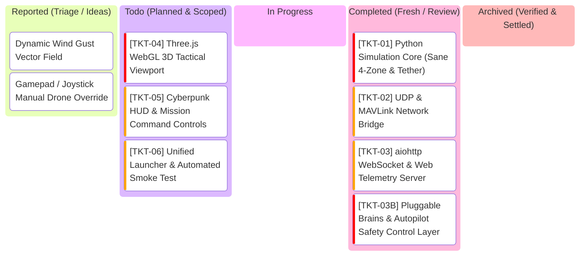

# SwarmTech3_UpRising: Project Kanban Board

---

## 1. Visual Task Lifecycle Board

---

## 2. Bug Log & Engineering Specs Table

| Ticket ID | Feature / Component | Priority | Status | Acceptance Criteria | Test Command | Root Cause & Engineering Solution |
| :--- | :--- | :--- | :--- | :--- | :--- | :--- |
| **TKT-01** | Python Simulation Core (`sim_core.py`) | **Very High** | **Review** | - Physical radius $R=0.75\text{m}$, clash at $d \le 1.5\text{m}$. - Relative velocity damping in Zone 3 ($1.5\text{m}-3.5\text{m}$) prevents collisions. - Tether avoidance ($3\text{m}$) and snap on collision ($1.0\text{m}$). - 10 Hz Baud broadcast + LKP navigation on comms lost ($>120\text{m}$). - Autonomic succession upon leader casualty. | `python -m unittest tests/test_sim_core.py` | Implemented vectorized 60 FPS boid kinematics in `sim_core.py` with physical 1.5m airframes, Zone 3 relative-velocity approach damping, tether clearance and snap mechanics, 10 Hz Baud radio broadcast with LKP recovery, and autonomic succession. 12/12 unit tests pass. |
| **TKT-02** | UDP & MAVLink Bridge (`mavlink_bridge.py`) | **High** | **Review** | - Broadcasts JSON telemetry array on UDP port 9000. - Listens for external commands on UDP port 9001. - Emits simulated MAVLink `HEARTBEAT` / `GLOBAL_POSITION_INT` on port 14550. | `python -m unittest tests/test_mavlink_bridge.py` | Implemented `MavlinkBridge` with non-blocking UDP sockets: port 9000 broadcasts swarm telemetry JSON, port 9001 ingests operator commands, port 14550 emits binary MAVLink v2 packets with GPS projection. 4/4 unit tests pass (16/16 total). |
| **TKT-03** | aiohttp WebSocket Server (`web_server.py`) | **High** | **Review** | - Serves static frontend files (`index.html`, CSS, JS). - WebSocket endpoint `/ws` streaming 60 FPS JSON snapshots. - Ingests operator commands from GCS. | `python -m unittest tests/test_web_server.py` | Implemented `SwarmWebServer` with aiohttp hosting static WebGL GCS assets, concurrent 60 FPS simulation ticker loop, and bidirectional WebSocket (`/ws`) streaming telemetry and ingesting operator commands. 4/4 unit tests pass (20/20 total). |
| **TKT-03B** | Pluggable Brains & Autopilot Safety (`backend/brains/`) | **Very High** | **Review** | - Zone 2/3 safety treated as flight controller steering weights (control effort), not god-mode physics walls. - Pluggable Brain plugin interface (`BaseBrain`). - `LeaderFollowerBrain`: tethered leader, star comms, LKP failover. - `GossipConsensusBrain`: P2P mesh, target gossip echo wave, quorum consensus, synchronized vector bank. - Hot-swappable at runtime via `SET_BRAIN`. | `python -m unittest tests/test_brains.py` | Implemented modular plugin architecture in `backend/brains/` (`LeaderFollowerBrain`, `GossipConsensusBrain`). Zone 2/3 safety treated as bounded motor control effort, Zone 4 as sole physical clash. 5/5 unit tests pass (25/25 total). |
| **TKT-04** | Three.js WebGL Viewport (`app.js`) | **Very High** | **Todo** | - 60 FPS GPU 3D rendering (zero CPU software projection). - True 3D quadcopter meshes with spinning rotors. - 3D drop-lines to $(X, Y, 0)$ ground coordinates. - Range rings tilt naturally in 3D perspective. - Dynamic glowing catenary tether strip. | Browser smoke test (`http://localhost:8080`) | Replaced CPU `QPainter` manual projection with native WebGL GPU pipeline. |
| **TKT-05** | Cyberpunk HUD & Controls (`hud.js`) | **High** | **Todo** | - Telemetry cards (ID, alt, battery, link status, LKP badge). - Mission dispatch (Target beacon placement). - Formation selector (Echelon, Boids, Vortex, Patrol). - Casualty lab (Kill Leader, Reboot Drone, Cut Tether). | Browser UI interaction test | Replaces unstable QPainter brush bleeding with clean, modern CSS/HTML HUD. |
| **TKT-06** | Unified Launcher & Smoke Test (`run.py`, `run.ps1`) | **High** | **Todo** | - Single-command startup: sets Conda path, starts sim server, auto-opens browser. - Headless verification mode (`--smoke-test`) exits code 0 in 2.0s. | `.\run.ps1 -SmokeTest` | Provides seamless zero-configuration execution for user. |

---

## 3. Strict Kanban Governance Rules
1. **WIP = 1**: At most one active ticket in `In Progress` at any time.
2. **Verification Gate**: No ticket moves to `Completed` without passing automated unit tests or smoke tests.
3. **User Sign-Off**: Cards in `Completed` remain for user testing and review until explicitly approved for archival.
