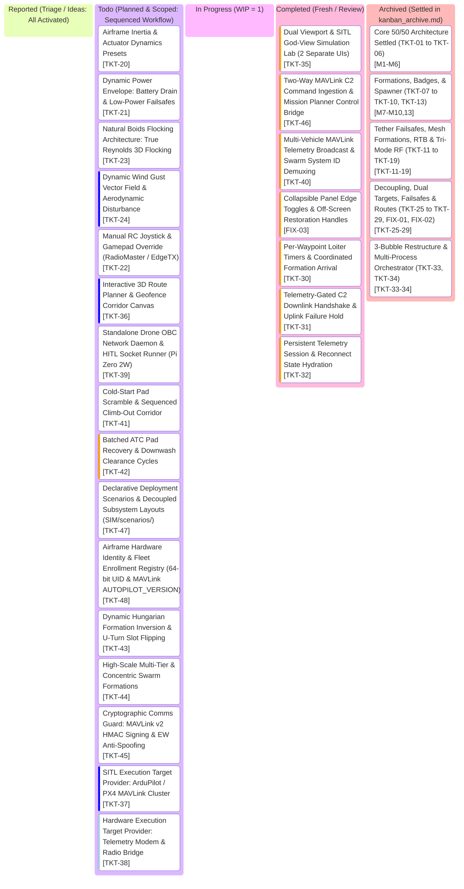

# AlitheiaHive_v3-Uprising: Project Kanban Board

> **Tactical GCS Workflow & Task Lifecycle** | **Palette: Dark Navy (#061019) & Neon Cyan (#00F0FF)**  
> *50/50 Architecture: Pure Python Kinematics & GPU-Native Three.js Rendering across 4 Airgaps*

---

## 1. Visual Task Lifecycle Board

---

## 2. Bug Log & Engineering Specs Table

> *Note: Detailed scoping and acceptance criteria are maintained across the 3-document architecture:*
> * **[kanban.md](kanban.md)**: Active working board & current specs table.
> * **[kanban_scope.md](kanban_scope.md)**: Deep technical architecture & planned implementation notes.
> * **[kanban_archive.md](kanban_archive.md)**: Settled milestones (`[TKT-01]` to `[TKT-19]`) and historical decisions (`[PLN-01]` to `[PLN-04]`).

| Ticket ID | Feature / Component | Priority | Status | Acceptance Criteria | Test Command | Root Cause & Engineering Solution |
| :--- | :--- | :--- | :--- | :--- | :--- | :--- |
| **TKT-32** | Persistent Telemetry Session & Reconnect State Hydration (`c2_gateway.py`, `hud.js`, `app.js`) | **High** | **Completed** | - Eliminate "mission amnesia" on browser page refresh. - Server-side circular event log buffer (`event_history: List[Dict]`, max 100 entries) capturing timestamps and event history. - Full GCS state hydration on WebSocket connect: Syncs active comms mode, active brain, active formation, RF jamming level, casualty set, active route progress, and event history, ensuring GCS reflects true persistent backend state on reload. | `python -m unittest tests/test_session_hydration.py` | Page refresh wiped browser event logs and UI states because GCS relied on transient browser RAM. Solution: Implement server-side telemetry history buffer and initial WebSocket state hydration. |
| **TKT-40** | Multi-Vehicle MAVLink Telemetry Broadcast & Swarm System ID Demuxing (`mavlink_bridge.py`) | **High** | **Completed** | - Vectorize MAVLink loopback emission across all active airframes in `self.sim.drones`. - Assign unique MAVLink `srcSystem = drone.id + 1` (Drone #0 -> sysid 1, Drone #1 -> sysid 2, ...). - Emit periodic `HEARTBEAT` (1 Hz) and `GLOBAL_POSITION_INT` (10 Hz) for every living drone. - External GCS (Mission Planner 1.3.x, QGroundControl) automatically discovers all drones on UDP port 14550 and displays the full formation simultaneously on the map. - Verified in `tests/test_mavlink_bridge.py`. | `python -m unittest tests/test_mavlink_bridge.py` | `MavlinkBridge` previously hardcoded `srcSystem = 1` and solely emitted packets for the leader (`self.sim.leader`), omitting all escorts. Solution: Dynamically assign distinct system IDs across all living drones during MAVLink packet encoding. |
| **TKT-31** | Telemetry-Gated C2 Downlink Handshake & Uplink Failure Hold (`c2_gateway.py`, `hud.js`) | **High** | **Completed** | - Address Trial 2: RNG beacon "going ham" on tether cut. - Decouple GCS arrival logic from physics ground truth: GCS detects arrival strictly via downlinked telemetry packets (`target_reached = True`). When umbilical/RF is severed, GCS receives NO arrival packets and flags `LINK_LOST`. - Uplink failure state machine: When `dispatch_target_uplink()` fails, GCS freezes the Commanded Target beacon, sets `rng_status = "UPLINK_OFFLINE"`, and halts all re-rolls instead of spamming 60 random targets/second. - Graceful recovery upon verified link reconnection. | `python -m unittest tests/test_c2_downlink_gate.py` | Trial 2 revealed GCS peeked at physics ground truth to trigger arrivals and spammed unthrottled uplinks on severed link. Solution: Enforce true telemetry-gated downlink arrivals and freeze commanded targets on uplink failure. |
| **TKT-30** | Per-Waypoint Loiter Timers & Coordinated Formation Arrival (`drone_obc.py`, `c2_gateway.py`, `hud.js`) | **High** | **Completed** | - Address Trial 1: Leader instantly transitions waypoints without waiting for escorts. - Waypoint schema supports 4D tuples: `[x, y, z, loiter_s]` or `{ "x": x, "y": y, "z": z, "loiter": loiter_s }`. - Autopilot OBC loiter state machine: Upon reaching $R_{\text{accept}} \le 2.5\text{m}$, flagship halts at station and initiates `wp_loiter_timer` countdown before advancing. - Route presets configured with distinct tactical loiters (`BOX_PATROL`, `DIAMOND_SURVEY`, `HEXAGON_SWEEP`). - Coordinated wing integrity: Optional settle check ensures trailing escorts close formation distance before loiter countdown elapses. - Live GCS HUD telemetry badge displays real-time countdown: `BOX [WP 2/4 (LOITER 2.8s)]`. | `python -m unittest tests/test_mission_routes.py` | Trial 1 identified that 0s loiter causes the flagship to abruptly cut corners and abandon followers. Solution: Add per-waypoint loiter timers and formation stabilization checks. |
| **TKT-20** | Airframe Inertia, Actuator Dynamics & Tuning Presets (`sitl_engine.py`, `app.js`, `hud.js`) | **Medium** | **Todo** | - Replace point-mass instantaneous kinematics with 1st-order motor response lag ($\dot{\mathbf{a}} = \frac{\mathbf{a}_{\text{target}} - \mathbf{a}}{\tau}$) with $\tau \in [0.04\text{s}, 0.16\text{s}]$. - Attitude tilt-thrust acceleration coupling: $\tan(\theta) = a_x / g$, $\tan(\phi) = a_y / g$, with angular slew rate limit ($|\dot{\theta}|, |\dot{\phi}| \le 250^\circ/\text{s}$) and maximum tilt clamp $\theta_{\text{max}}$. - Vectorized quadratic aerodynamic drag $\mathbf{a}_{\text{drag}} = -k_d \|\mathbf{v}\|\mathbf{v}$ providing realistic braking drift. - 3 Airframe Tuning Presets: `LIGHTWEIGHT_RACER`, `TACTICAL_RECON`, `HEAVY_PAYLOAD`. - GCS UI: 3-way preset selector toggle in Command Deck. | `python -m unittest tests/test_sim_core.py` | Point-mass kinematics yields instantaneous velocity vector jumps with zero aerodynamic drift or physical inertia. Solution: Implement 1st-order motor spool filter, tilt-thrust coupling, and quadratic drag vector. |
| **TKT-21** | Dynamic Power Envelope: Battery Drain Curves & Low-Power Failsafes (`sitl_engine.py`, `drone_obc.py`, `hud.js`) | **Medium** | **Todo** | - Non-linear LiPo discharge model: Instantaneous power $P(t) = P_{\text{avionics}} + P_{\text{hover}} \left(\frac{\|\mathbf{T}\|}{mg}\right)^{1.5} + P_{\text{aero}}(\mathbf{v})$. - Tether power asymmetry: In `TETHERED_RELAY`, Drone #0 is powered continuously via umbilical ($100\%$ locked); on tether sever/jettison, seamlessly transfers to internal battery backup. Escorts consume internal battery. - 2-Stage Low-Power Failsafe State Machine: Advisory Warning ($\le 25\%$) and Critical Emergency Soft-Landing ($\le 10\%$). - GCS UI: Live color-coded battery bars and voltage/wattage telemetry readouts. | `python -m unittest tests/test_rtb_landing.py` | Battery was a static 100% telemetry display without power curves or failure states. Solution: Implement thrust-dependent power integration and automated multi-stage battery failsafes. |
| **TKT-23** | Natural Boids Flocking Architecture: True Reynolds 3D Flocking (`backend/brains/`, `sitl_engine.py`) | **Medium** | **Todo** | - Replace rigid Cartesian grid world offsets in `NATURAL_FLOCK` with true Reynolds 3D boid flocking forces:   1. Separation ($d < 4.0\text{m}$)   2. Alignment ($d < 12.0\text{m}$)   3. Cohesion ($d < 16.0\text{m}$)   4. Centroid Goal Pull tracking consensus target or flagship position. - Enforces 3m tether clearance cylinder and altitude floor ($Z \ge 10.0\text{m}$). - Swarm dynamically compresses through corridors, streams around obstacles, and banks organically through turns with zero prop clashes ($d > 1.5\text{m}$). | `python -m unittest tests/test_brains.py` | Previous `NATURAL_FLOCK` relied on fixed Cartesian $(X, Y)$ world offsets, preventing organic turning or dynamic flocking. Solution: Implement vectorized 3D Reynolds acceleration weights in both brains combined with Zone 3 momentum damping. |
| **TKT-24** | Dynamic Wind Gust Vector Field & Aerodynamic Disturbance (`sitl_engine.py`, `app.js`, `hud.js`) | **Low** | **Todo** | - 3D Dryden / Perlin wind vector field: $\mathbf{v}_{\text{wind}}(\mathbf{x}, t) = \mathbf{v}_{\text{base}} + \mathbf{v}_{\text{gust}}(t)$. - Base wind speed configurable via GCS slider ($0\text{--}15\text{ m/s}$) and wind heading ($0\text{--}360^\circ$). - Aerodynamic disturbance force applied to airframes: $\mathbf{F}_{\text{wind}} = \frac{1}{2} \rho C_d A \|\mathbf{v}_{\text{rel}}\| \mathbf{v}_{\text{rel}}$ where $\mathbf{v}_{\text{rel}} = \mathbf{v}_{\text{wind}} - \mathbf{v}_{\text{drone}}$. - Autopilot crab angle: Drones automatically lean into crosswinds to hold precision formation slots. - GCS UI: Cyberpunk compass rose HUD widget with live wind vector arrow, m/s readout, and gust intensity indicator. | `python -m unittest tests/test_sim_core.py` | Airframe simulation operates in ideal dead-calm air. Solution: Vectorize dynamic wind field acceleration in physics engine, model crosswind drift, and expose operator wind controls. |
| **TKT-22** | Manual RC Joystick & Gamepad Override (`hud.js`, `c2_gateway.py`, `drone_obc.py`) | **Medium** | **Todo** | - Ingest USB-C HID RC controllers (RadioMaster Pocket CC2500, TX16S in EdgeTX joystick mode) and standard gamepads (Xbox, PlayStation) via HTML5 Gamepad API in `frontend/js/hud.js`. - 4-axis flight stick mapping: Left Stick (Throttle $\pm v_z$ + Yaw rate $\dot{\psi}$), Right Stick (Pitch $+X$ velocity + Roll $+Y$ strafe velocity). - Deadband threshold ($0.08$) and exponential curve ($\text{expo} = 0.3$) for precision stick feel. - Mode toggle: `MANUAL_OVERRIDE` command sent over `/ws` to pilot Flagship (Drone #0). Escort swarm tracks formation dynamically around human pilot. - Failsafe timeout: Reverts to autonomous loiter if gamepad signal is lost for $>1.0\text{s}$. | `python -m unittest tests/test_web_server.py` | Operators lacked direct pilot stick control over flight trajectories. Solution: Implement browser-native Gamepad API loop in `hud.js` and direct velocity-demand control in OBC. |
| **FIX-03** | Collapsible Panel Edge Toggles & Off-Screen Restoration Handles (`index.html`, `style.css`, `hud.js`) | **High** | **Completed** | - Collapsing `FLEET TELEMETRY` or `COMMAND DECK` smoothly slides the panel off-screen but reveals edge-docked Cyberpunk cyan restoration tabs pinned to the screen viewport (`left: 0` / `right: 0`). - Left tab: `► FLEET` expands the telemetry panel; Right tab: `COMMAND ◄` expands the command deck. - Clicking an edge tab slides the panel back into view and hides the edge tab. - Panel collapse buttons inside headers toggle panels cleanly without leaving orphaned or unrecoverable states. - Tested via DOM inspection and web server asset assertions. | `python -m unittest tests/test_web_server.py` | `#left-panel.collapsed` and `#right-panel.collapsed` translated panels `-340px` and `+360px`, sliding the header toggle buttons completely off-screen with zero remaining UI elements to restore them. Solution: Add viewport-docked `.edge-restore-tab` handles that appear when panels are collapsed. |
| **TKT-35** | Dual Viewport & SITL God-View Simulation Lab — The 2 Separate UIs (`GCS/frontend/`, `SIM/frontend/`, `web_server.py`) | **High** | **Completed** | - Strict UI Airgap decoupling into 2 independent web viewports:   1. **Operator Tactical GCS** (`GCS/frontend/` at `http://localhost:8080/`): Pure operator terminal displaying only downlinked telemetry packets. Exposes flight commands (waypoints, routes, formations, brain selection, RTB). Zero god-mode/casualty buttons.   2. **SITL God-View Simulation Lab** (`SIM/frontend/` at `http://localhost:8080/sim`): Neon Magenta theme (`#FF00EA`). Omniscient Three.js viewport showing unfiltered true physical positions, Zone 4 ghost collision spheres ($d \le 1.5\text{m}$), tether tension vectors, RF propagation range dome ($120\text{m}$), and full casualty injection deck (sever umbilical, kill motor, RF jamming noise, wind disturbance). - Enforces the Operator vs Sim Airgap: operators never see simulation fault injectors. | `python -m unittest tests/test_web_server.py` | GCS previously co-located operator flight controls with simulation fault injection buttons (jamming slider, kill leader), violating the 4 Airgaps. Solution: Split frontend into 2 dedicated UIs. |
| **TKT-39** | Standalone Drone OBC Network Daemon & HITL Socket Runner for Raspberry Pi Zero 2W (`OBC/runner.py`, `drone_firmware.py`) | **Medium** | **Todo** | - Standalone daemon entrypoint: `python -m OBC.runner --drone-id <ID> --sim-ip <IP> --gcs-ip <IP>`. - Hardware-in-the-Loop (HITL) socket architecture: Ingests synthetic sensor UDP frames from `SIM` (IMU, GPS, baro, RF RSSI), executes local estimators and pluggable brains (Leader-Follower / Gossip Consensus) on physical Raspberry Pi Zero 2W, emits actuator velocity commands back to `SIM` (or real ESCs), and streams MAVLink/JSON telemetry to `GCS`. - Proves 100% plug-and-play modularity across the 3 bubbles: GCS can be swapped for Mission Planner/QGC, SIM can be swapped for Gazebo, and OBC can run on real embedded Linux hardware. | `python -m unittest tests/test_brains.py` | OBC firmware was orchestrated strictly within the top-layer Python process. Solution: Decouple OBC into an independent socket daemon supporting HITL and distributed multi-machine deployment. |
| **TKT-41** | Cold-Start Pad Scramble & Sequenced Climb-Out Corridor (`sitl_engine.py`, `app.js`, `hud.js`) | **Medium** | **Todo** | - Drones initialize cold on numbered ground pads ($Z = 0.05\text{m}$, props stationary, `flight_state = "GROUND_IDLE"`). - Umbilical spool retracted at base anchor. - Sequenced Scramble: Flagship #0 spins up and ascends vertically to $Z = 20\text{m}$, deploying umbilical; escorts spool up staggered every 1.2s, climb along safe departure corridors, and muster into formation slots around flagship at RTB station. - GCS command `SCRAMBLE_SWARM` with manual and auto-boot options. | `python -m unittest tests/test_sim_core.py` | Drones previously initialized mid-air in continuous cruise. Solution: Add grounded startup states, sequential spooling, and climb-out departure corridors. |
| **TKT-42** | Batched ATC Pad Recovery & Downwash Clearance Cycles (`sitl_engine.py`, `c2_gateway.py`, `hud.js`) | **High** | **Todo** | - Air Traffic Control (ATC) state machine with configurable pad capacity ($N_{\text{pads}} = 8$). - Downwash vortex gate: Drone $k+1$ is altitude-held above ground effect until Drone $k$ confirms `TOUCHDOWN_CONFIRMED` ($Z \le 0.1\text{m}$, speed $\le 0.05\text{ m/s}$, motors disarmed). - Wave management: Once 8 pads are filled, remaining drones hold at overhead marshal shelves ($Z \in [25, 35]\text{m}$). - Base Horizon RF Dome: Within $50\text{m}$ radius, high-gain base radio guarantees 100% link. - GCS `[CLEAR PADS // NEXT WAVE]` button (or 12s countdown timer) resets pads and clears the next wave for landing. | `python -m unittest tests/test_rtb_landing.py` | Large fleets overwhelmed 8 pads by landing outside in the dirt with dangerous rapid descent intervals. Solution: Implement touchdown gating, overhead marshal holding, and batched wave clearance cycles. |
| **TKT-47** | Declarative Field Deployment Scenarios & Decoupled Subsystem Layouts (`SIM/scenarios/`, `sitl_engine.py`, `app.js`) | **Medium** | **Todo** | - Decouple single $(0, 0, 0)$ origin into dedicated subsystem positions:   1. `datum: { lat, lon, alt }`: Geographic home anchor (Tokyo Bay default).   2. `gcs_mast: [x, y, z]`: Radio mast & operator station.   3. `rtk_tripod: [x, y, z]`: Independent RTK base tripod.   4. `tether_winch: [x, y, z]`: Umbilical winch/spool separated from landing pads.   5. `landing_zone`: Configurable center, heading, and pad spacing for portable rollout mats or mobile trailers. - Declarative JSON presets under `SIM/scenarios/` (`tokyo_waterfront.json`, `mobile_van_deployment.json`). - SIM downlinks layout via state snapshot; Three.js viewport draws pads, winch, tripod, and mast at their true scenario coordinates with zero manual UI setup. - RTB soft-landing navigates to scenario pad coordinates. | `python -m unittest tests/test_sim_core.py` | Ground components (GCS mast, tether anchor, landing pads) were previously clumped at identical origin $(0, 0, 0)$, creating collision and tether entanglement risks in mobile operations. Solution: Implement declarative scenario loader and decoupled subsystem offsets. |
| **TKT-48** | Airframe Hardware Identity & Fleet Enrollment Registry (`sitl_engine.py`, `mavlink_bridge.py`, `hud.js`) | **Medium** | **Todo** | - Replace anonymous array indices (`Drone #0`, `#1`) with true hardware UIDs and tactical tail numbers:   1. **64-bit MCU Hardware UID**: Unique silicon serial (`hardware_uid`) generated or read from MCU/EEPROM.   2. **Tactical Tail Numbers / Call-Signs**: Alphanumeric airframe IDs (e.g. `ALITHEIA-V01` through `V08`, reserves `ALITHEIA-RES-01`).   3. **Fleet Enrollment Registry**: Maps physical airframe UIDs to dynamic swarm slots and MAVLink `sysid`. - MAVLink Handshake: Responds to `AUTOPILOT_VERSION` (#148) with real `uid2` silicon serial; responds to `PARAM_REQUEST_LIST` (#21) with minimal parameter table (`SYSID_THISMAV`, `FRAME_CLASS`) to dismiss Mission Planner "Getting Params..." dialog in 0.02s. - Casualty Preservation: Downed airframes preserve their unique hardware UID and LKP in mission logs; newly scrambled reinforcements enroll with fresh hardware UIDs. | `python -m unittest tests/test_mavlink_bridge.py` | Real fleets do not use transient zero-indexed integers as vehicle identities. Mission Planner hangs on "Getting Params..." when parameter requests are unhandled. Solution: Implement hardware UID registry, parameter table responder, and casualty tail logging. |
| **TKT-43** | Dynamic Hungarian Formation Inversion & U-Turn Slot Flipping (`leader_follower.py`, `gossip_consensus.py`) | **Medium** | **Todo** | - Distance-minimizing slot assignment on heading reversals ($> 120^\circ$, $\mathbf{v}_{\text{old}} \cdot \mathbf{v}_{\text{new}} < -0.5$). - Solves $\min \sum \|p_i - s_j\|^2$ using greedy nearest-neighbor or Hungarian matching. - Trailing wingtip drones immediately claim the new vanguard slots in the reversed direction, while forward drones ease back into the trail. - Eliminates 80m cross-flight drag races, formation distortion, and prop clash risks during sharp U-turns. | `python -m unittest tests/test_brains.py` | Rigid slot indexing forced trailing drones to fly long cross-formation paths during 180° turns. Solution: Dynamically re-index slot assignments based on spatial proximity. |
| **TKT-44** | High-Scale Multi-Tier & Concentric Swarm Formations (`sitl_engine.py`, `backend/brains/`) | **Medium** | **Todo** | - Prevent formation scale blowout and RF link degradation at $N \ge 16\text{--}48$. - Multi-tier stacked echelons: Stacked sub-flights (Alpha, Bravo, Charlie) stepped 10m back and 2.5m higher like a strike package. - Concentric orbital shells for `ORBIT_VORTEX` and `PERIMETER`: Inner shell ($R=12\text{m}$), Mid shell ($R=24\text{m}$), Outer shell ($R=36\text{m}$). - Keeps all airframes within dense RF range ($< 60\text{m}$) while maintaining full 3m safety clearance envelope. | `python -m unittest tests/test_brains.py` | Single-tier formations stretch beyond the 120m radio horizon at large drone counts. Solution: Implement multi-tier stacked echelons and concentric orbital shells. |
| **TKT-45** | Cryptographic Comms Guard: MAVLink v2 HMAC Signing & EW Anti-Spoofing (`mavlink_bridge.py`, `sitl_engine.py`, `hud.js`) | **Medium** | **Todo** | - Cryptographic MAVLink v2 Packet Signing (`MAVLINK_IFLAG_SIGNED`): 32-byte shared secret key + SHA-256 HMAC signature + 48-bit monotonic timestamp to defeat replay attacks. - Electronic Warfare (EW) Adversary Spoofing Simulator in SIM Lab: `[INJECT ROGUE C2 PACKET]` broadcasts spoofed waypoint overrides. - Defense verification: In Signed mode, OBC drops unauthorized packets (`AUTH_FAILURE`) and emits GCS HUD alarm (`[EW ALERT] Rogue spoofing attempt rejected`). In Unsigned mode, rogue packet hijacks swarm heading. - Gossip Mesh Peer Tokens: Cryptographic peer identity prevents Sybil node consensus poisoning. | `python -m unittest tests/test_mavlink_bridge.py` | Unauthenticated MAVLink and gossip packets allow adversary SDR packet injection and waypoint hijacking. Solution: Implement MAVLink v2 HMAC-SHA256 signature validation and anti-spoofing filters. |
| **TKT-46** | Two-Way MAVLink C2 Command Ingestion & Mission Planner Control Bridge (`mavlink_bridge.py`, `sitl_engine.py`) | **High** | **Completed** | - Non-blocking inbound MAVLink packet listener on `self.mavlink_sock` receiving commands from Mission Planner / QGroundControl. - Broadcast `HOME_POSITION` (#242) and `GPS_GLOBAL_ORIGIN` (#49) anchored to dynamic SIM home coordinates (Tokyo Bay: `HOME_LAT = 35.625971`, `HOME_LON = 139.734759`, `HOME_ALT = 20.0m`) so external GCS auto-centers on our launch site. - Ingests `SET_POSITION_TARGET_GLOBAL_INT` / `SET_POSITION_TARGET_LOCAL_NED`: Converts clicked GPS coordinates `(lat, lon, alt)` back to Cartesian `[x, y, z]`. - **Safety Geofence Clamp & Rejection Gate**: Enforces maximum horizontal radius $R_{\text{horiz}} \le 120.0\text{m}$ (matching GCS RF horizon ring) and altitude clamp $Z \in [5.0, 45.0]\text{m}$. Rejects clicks in Timbuktu ($> 120\text{m}$) with `COMMAND_ACK(MAV_RESULT_DENIED)` and HUD warning. - Ingests `COMMAND_LONG`: `MAV_CMD_NAV_TAKEOFF` (scramble), `MAV_CMD_NAV_RETURN_TO_LAUNCH` (`RTB_HOLD`), `MAV_CMD_NAV_LAND` (`LAND_SWARM`), `MAV_CMD_COMPONENT_ARM_DISARM`. - Emits `COMMAND_ACK` with `MAV_RESULT_ACCEPTED` so Mission Planner confirms execution. - Supports broadcast (`target_system = 0/1`) and individual drone sysid targeting. | `python -m unittest tests/test_mavlink_bridge.py` | Mission Planner was strictly read-only downlink. Solution: Add inbound binary MAVLink packet parsing, coordinate inverse projection from dynamic SIM home, safety geofence clamp, and command routing. |
| **TKT-36** | Interactive 3D Route Planner & Geofence Corridor Canvas (`frontend/js/app.js`, `frontend/js/hud.js`) | **Low** | **Todo** | - Interactive 3D polyline corridor drawing with altitude shelves, Dubins path turn smoothing, and automated survey grids. - 3D cylindrical and polygonal keep-out threat volumes (No-Fly Zones) with red holographic visual fencing. - Export custom drawn routes directly to discrete waypoint queue format (`UPLOAD_MISSION_ROUTE`). | Visual Viewport Check | Settles PLN-13. Operators lacked custom in-viewport route creation tools. Solution: Add interactive 3D canvas drawing tools to Three.js viewport. |
| **TKT-37** | SITL Execution Target Provider: ArduPilot / PX4 MAVLink Cluster (`backend/providers/sitl_provider.py`) | **Low** | **Todo** | - Multi-instance SITL bridge via MAVLink UDP (port 14550), swapping internal kinematics for real autopilot firmware running in simulated GPS environments. - Supports `MISSION_ITEM_INT`, `COMMAND_LONG` (takeoff, land, RTL, loiter), and `PARAM_SET`. | Headless SITL Test | Settles PLN-11. SwarmTech3 runs in-memory kinematics. This provider enables testing against real autopilot firmware stacks without changing the GCS. |
| **TKT-38** | Hardware Execution Target Provider: Telemetry Modem & Radio Bridge (`backend/providers/hardware_provider.py`) | **Very Low** | **Todo** | - Pure lategame hardware adapter. - Ingests live telemetry from USB serial radios (RFD900x / Holybro SiK / ExpressLRS) or 4G LTE cellular VPN bridges, routing physical MAVLink packets directly into the 3D WebGL tactical viewport. | Hardware Radio Test | Settles PLN-12. Prepares SwarmTech C2 core for physical field operations with real carbon-fiber airframes. |

---

## 3. Strict Kanban Governance Rules
1. **WIP = 1**: At most one active ticket in `In Progress` at any time.
2. **Verification Gate (Code Deliverables Only)**: Code tickets require passing their targeted test module before moving to `Completed`. Non-code changes (documentation, board theme/layout, comments) require zero tests.
3. **User Sign-Off**: Cards in `Completed` remain for user testing and review until explicitly approved for archival.
