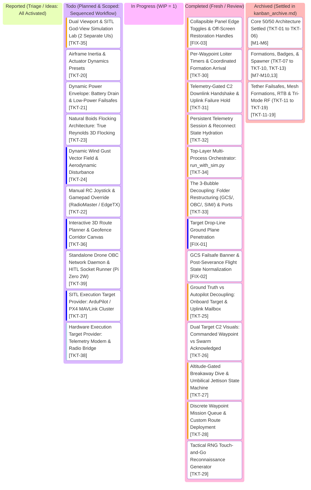

# AlitheiaHive_v3-Uprising: Project Kanban Board

> **Tactical GCS Workflow & Task Lifecycle** | **Palette: Dark Navy (#061019) & Neon Cyan (#00F0FF)**  
> *50/50 Architecture: Pure Python Kinematics & GPU-Native Three.js Rendering across 4 Airgaps*

---

## 1. Visual Task Lifecycle Board

---

## 2. Bug Log & Engineering Specs Table

> *Note: Detailed scoping and acceptance criteria are maintained across the 3-document architecture:*
> * **[kanban.md](kanban.md)**: Active working board & current specs table.
> * **[kanban_scope.md](kanban_scope.md)**: Deep technical architecture & planned implementation notes.
> * **[kanban_archive.md](kanban_archive.md)**: Settled milestones (`[TKT-01]` to `[TKT-19]`) and historical decisions (`[PLN-01]` to `[PLN-04]`).

| Ticket ID | Feature / Component | Priority | Status | Acceptance Criteria | Test Command | Root Cause & Engineering Solution |
| :--- | :--- | :--- | :--- | :--- | :--- | :--- |
| **TKT-33** | The 3-Bubble Decoupling Architecture: Folder Restructuring (GCS/, OBC/, SIM/) & Local Port Protocol (`GCS/`, `OBC/`, `SIM/`) | **High** | **Completed** | - Standardize repository directory topology around the 3 physical bubbles:   1. `GCS/`: `backend/` (C2 mission gateway, routes, RNG recon, web server), `frontend/` (operator tactical Three.js viewport).   2. `OBC/`: `backend/` (drone firmware, pluggable brains, local estimators, failsafes), `frontend/` (staged for log analysis).   3. `SIM/`: `backend/` (SITL physics engine, ideal FC twin, tether dynamics, RF channel, casualty injector), `frontend/` (god-view truth viewport). - Zero cross-process memory leaks; bubbles communicate strictly over local ports: UDP 9000 (Telemetery TX), UDP 9001 (Command RX), UDP 14550 (MAVLink v2), WS 8080. - Update imports and test discovery suite to cleanly resolve from modular packages. | `python -m unittest discover tests` | Previous architecture intertwined GCS mission generators, world physics, and drone autopilots into a single monolithic class. Solution: Strict process, folder, and socket separation enforcing the 4 Airgaps. |
| **TKT-34** | Top-Layer Multi-Process Orchestrator (`run_with_sim.py`, `run.ps1`) | **High** | **Completed** | - Standalone top-layer launcher that boots the 3 independent bubbles in strict order:   1. SITL World Engine (port 9000/9001/14550)   2. Drone OBC Fleet   3. Tactical GCS C2 Gateway & Web Server (port 8080)   4. Default browser launch - Bubbles do not spawn each other; orchestrator manages clean lifecycles, signal handling (`SIGINT`), and graceful multi-process teardown. - CLI flags: `--gcs-only` (connects to external sim or hardware), `--sim-only` (headless SITL mode), `--smoke-test`. | `python run_with_sim.py --smoke-test` | Interdependent process creation caused tight coupling. Solution: Implement an external top-layer orchestrator for modular startup and standalone lifecycle management. |
| **TKT-32** | Persistent Telemetry Session & Reconnect State Hydration (`c2_gateway.py`, `hud.js`, `app.js`) | **High** | **Completed** | - Eliminate "mission amnesia" on browser page refresh. - Server-side circular event log buffer (`event_history: List[Dict]`, max 100 entries) capturing timestamps and event history. - Full GCS state hydration on WebSocket connect: Syncs active comms mode, active brain, active formation, RF jamming level, casualty set, active route progress, and event history, ensuring GCS reflects true persistent backend state on reload. | `python -m unittest tests/test_session_hydration.py` | Page refresh wiped browser event logs and UI states because GCS relied on transient browser RAM. Solution: Implement server-side telemetry history buffer and initial WebSocket state hydration. |
| **TKT-31** | Telemetry-Gated C2 Downlink Handshake & Uplink Failure Hold (`c2_gateway.py`, `hud.js`) | **High** | **Completed** | - Address Trial 2: RNG beacon "going ham" on tether cut. - Decouple GCS arrival logic from physics ground truth: GCS detects arrival strictly via downlinked telemetry packets (`target_reached = True`). When umbilical/RF is severed, GCS receives NO arrival packets and flags `LINK_LOST`. - Uplink failure state machine: When `dispatch_target_uplink()` fails, GCS freezes the Commanded Target beacon, sets `rng_status = "UPLINK_OFFLINE"`, and halts all re-rolls instead of spamming 60 random targets/second. - Graceful recovery upon verified link reconnection. | `python -m unittest tests/test_c2_downlink_gate.py` | Trial 2 revealed GCS peeked at physics ground truth to trigger arrivals and spammed unthrottled uplinks on severed link. Solution: Enforce true telemetry-gated downlink arrivals and freeze commanded targets on uplink failure. |
| **TKT-30** | Per-Waypoint Loiter Timers & Coordinated Formation Arrival (`drone_obc.py`, `c2_gateway.py`, `hud.js`) | **High** | **Completed** | - Address Trial 1: Leader instantly transitions waypoints without waiting for escorts. - Waypoint schema supports 4D tuples: `[x, y, z, loiter_s]` or `{ "x": x, "y": y, "z": z, "loiter": loiter_s }`. - Autopilot OBC loiter state machine: Upon reaching $R_{\text{accept}} \le 2.5\text{m}$, flagship halts at station and initiates `wp_loiter_timer` countdown before advancing. - Route presets configured with distinct tactical loiters (`BOX_PATROL`, `DIAMOND_SURVEY`, `HEXAGON_SWEEP`). - Coordinated wing integrity: Optional settle check ensures trailing escorts close formation distance before loiter countdown elapses. - Live GCS HUD telemetry badge displays real-time countdown: `BOX [WP 2/4 (LOITER 2.8s)]`. | `python -m unittest tests/test_mission_routes.py` | Trial 1 identified that 0s loiter causes the flagship to abruptly cut corners and abandon followers. Solution: Add per-waypoint loiter timers and formation stabilization checks. |
| **TKT-20** | Airframe Inertia, Actuator Dynamics & Tuning Presets (`sitl_engine.py`, `app.js`, `hud.js`) | **Medium** | **Todo** | - Replace point-mass instantaneous kinematics with 1st-order motor response lag ($\dot{\mathbf{a}} = \frac{\mathbf{a}_{\text{target}} - \mathbf{a}}{\tau}$) with $\tau \in [0.04\text{s}, 0.16\text{s}]$. - Attitude tilt-thrust acceleration coupling: $\tan(\theta) = a_x / g$, $\tan(\phi) = a_y / g$, with angular slew rate limit ($|\dot{\theta}|, |\dot{\phi}| \le 250^\circ/\text{s}$) and maximum tilt clamp $\theta_{\text{max}}$. - Vectorized quadratic aerodynamic drag $\mathbf{a}_{\text{drag}} = -k_d \|\mathbf{v}\|\mathbf{v}$ providing realistic braking drift. - 3 Airframe Tuning Presets: `LIGHTWEIGHT_RACER`, `TACTICAL_RECON`, `HEAVY_PAYLOAD`. - GCS UI: 3-way preset selector toggle in Command Deck. | `python -m unittest tests/test_sim_core.py` | Point-mass kinematics yields instantaneous velocity vector jumps with zero aerodynamic drift or physical inertia. Solution: Implement 1st-order motor spool filter, tilt-thrust coupling, and quadratic drag vector. |
| **TKT-21** | Dynamic Power Envelope: Battery Drain Curves & Low-Power Failsafes (`sitl_engine.py`, `drone_obc.py`, `hud.js`) | **Medium** | **Todo** | - Non-linear LiPo discharge model: Instantaneous power $P(t) = P_{\text{avionics}} + P_{\text{hover}} \left(\frac{\|\mathbf{T}\|}{mg}\right)^{1.5} + P_{\text{aero}}(\mathbf{v})$. - Tether power asymmetry: In `TETHERED_RELAY`, Drone #0 is powered continuously via umbilical ($100\%$ locked); on tether sever/jettison, seamlessly transfers to internal battery backup. Escorts consume internal battery. - 2-Stage Low-Power Failsafe State Machine: Advisory Warning ($\le 25\%$) and Critical Emergency Soft-Landing ($\le 10\%$). - GCS UI: Live color-coded battery bars and voltage/wattage telemetry readouts. | `python -m unittest tests/test_rtb_landing.py` | Battery was a static 100% telemetry display without power curves or failure states. Solution: Implement thrust-dependent power integration and automated multi-stage battery failsafes. |
| **TKT-23** | Natural Boids Flocking Architecture: True Reynolds 3D Flocking (`backend/brains/`, `sitl_engine.py`) | **Medium** | **Todo** | - Replace rigid Cartesian grid world offsets in `NATURAL_FLOCK` with true Reynolds 3D boid flocking forces:   1. Separation ($d < 4.0\text{m}$)   2. Alignment ($d < 12.0\text{m}$)   3. Cohesion ($d < 16.0\text{m}$)   4. Centroid Goal Pull tracking consensus target or flagship position. - Enforces 3m tether clearance cylinder and altitude floor ($Z \ge 10.0\text{m}$). - Swarm dynamically compresses through corridors, streams around obstacles, and banks organically through turns with zero prop clashes ($d > 1.5\text{m}$). | `python -m unittest tests/test_brains.py` | Previous `NATURAL_FLOCK` relied on fixed Cartesian $(X, Y)$ world offsets, preventing organic turning or dynamic flocking. Solution: Implement vectorized 3D Reynolds acceleration weights in both brains combined with Zone 3 momentum damping. |
| **TKT-24** | Dynamic Wind Gust Vector Field & Aerodynamic Disturbance (`sitl_engine.py`, `app.js`, `hud.js`) | **Low** | **Todo** | - 3D Dryden / Perlin wind vector field: $\mathbf{v}_{\text{wind}}(\mathbf{x}, t) = \mathbf{v}_{\text{base}} + \mathbf{v}_{\text{gust}}(t)$. - Base wind speed configurable via GCS slider ($0\text{--}15\text{ m/s}$) and wind heading ($0\text{--}360^\circ$). - Aerodynamic disturbance force applied to airframes: $\mathbf{F}_{\text{wind}} = \frac{1}{2} \rho C_d A \|\mathbf{v}_{\text{rel}}\| \mathbf{v}_{\text{rel}}$ where $\mathbf{v}_{\text{rel}} = \mathbf{v}_{\text{wind}} - \mathbf{v}_{\text{drone}}$. - Autopilot crab angle: Drones automatically lean into crosswinds to hold precision formation slots. - GCS UI: Cyberpunk compass rose HUD widget with live wind vector arrow, m/s readout, and gust intensity indicator. | `python -m unittest tests/test_sim_core.py` | Airframe simulation operates in ideal dead-calm air. Solution: Vectorize dynamic wind field acceleration in physics engine, model crosswind drift, and expose operator wind controls. |
| **TKT-22** | Manual RC Joystick & Gamepad Override (`hud.js`, `c2_gateway.py`, `drone_obc.py`) | **Medium** | **Todo** | - Ingest USB-C HID RC controllers (RadioMaster Pocket CC2500, TX16S in EdgeTX joystick mode) and standard gamepads (Xbox, PlayStation) via HTML5 Gamepad API in `frontend/js/hud.js`. - 4-axis flight stick mapping: Left Stick (Throttle $\pm v_z$ + Yaw rate $\dot{\psi}$), Right Stick (Pitch $+X$ velocity + Roll $+Y$ strafe velocity). - Deadband threshold ($0.08$) and exponential curve ($\text{expo} = 0.3$) for precision stick feel. - Mode toggle: `MANUAL_OVERRIDE` command sent over `/ws` to pilot Flagship (Drone #0). Escort swarm tracks formation dynamically around human pilot. - Failsafe timeout: Reverts to autonomous loiter if gamepad signal is lost for $>1.0\text{s}$. | `python -m unittest tests/test_web_server.py` | Operators lacked direct pilot stick control over flight trajectories. Solution: Implement browser-native Gamepad API loop in `hud.js` and direct velocity-demand control in OBC. |
| **FIX-03** | Collapsible Panel Edge Toggles & Off-Screen Restoration Handles (`index.html`, `style.css`, `hud.js`) | **High** | **Completed** | - Collapsing `FLEET TELEMETRY` or `COMMAND DECK` smoothly slides the panel off-screen but reveals edge-docked Cyberpunk cyan restoration tabs pinned to the screen viewport (`left: 0` / `right: 0`). - Left tab: `► FLEET` expands the telemetry panel; Right tab: `COMMAND ◄` expands the command deck. - Clicking an edge tab slides the panel back into view and hides the edge tab. - Panel collapse buttons inside headers toggle panels cleanly without leaving orphaned or unrecoverable states. - Tested via DOM inspection and web server asset assertions. | `python -m unittest tests/test_web_server.py` | `#left-panel.collapsed` and `#right-panel.collapsed` translated panels `-340px` and `+360px`, sliding the header toggle buttons completely off-screen with zero remaining UI elements to restore them. Solution: Add viewport-docked `.edge-restore-tab` handles that appear when panels are collapsed. |
| **TKT-35** | Dual Viewport & SITL God-View Simulation Lab — The 2 Separate UIs (`GCS/frontend/`, `SIM/frontend/`, `c2_gateway.py`) | **High** | **Todo** | - Strict UI Airgap decoupling into 2 independent web viewports:   1. **Operator Tactical GCS** (`GCS/frontend/` at `http://localhost:8080/`): Pure operator terminal displaying only downlinked telemetry packets. Exposes flight commands (waypoints, routes, formations, brain selection, RTB). Zero god-mode/casualty buttons.   2. **SITL God-View Simulation Lab** (`SIM/frontend/` at `http://localhost:8080/sim` or port 8081): Neon Magenta theme (`#FF00EA`). Omniscient Three.js viewport showing unfiltered true physical positions, ghost collision spheres, tether stress vectors, RF propagation range bubbles ($120\text{m}$), and full casualty injection deck (sever umbilical, kill motor, RF jamming noise, wind disturbance). - Enforces the Operator vs Sim Airgap: operators never see simulation fault injectors. | Visual Inspection / Unit Test | GCS currently co-locates operator flight controls with simulation fault injection buttons (jamming slider, kill leader), violating the 4 Airgaps. Solution: Split frontend into 2 dedicated UIs. |
| **TKT-39** | Standalone Drone OBC Network Daemon & HITL Socket Runner for Raspberry Pi Zero 2W (`OBC/runner.py`, `drone_firmware.py`) | **Medium** | **Todo** | - Standalone daemon entrypoint: `python -m OBC.runner --drone-id <ID> --sim-ip <IP> --gcs-ip <IP>`. - Hardware-in-the-Loop (HITL) socket architecture: Ingests synthetic sensor UDP frames from `SIM` (IMU, GPS, baro, RF RSSI), executes local estimators and pluggable brains (Leader-Follower / Gossip Consensus) on physical Raspberry Pi Zero 2W, emits actuator velocity commands back to `SIM` (or real ESCs), and streams MAVLink/JSON telemetry to `GCS`. - Proves 100% plug-and-play modularity across the 3 bubbles: GCS can be swapped for Mission Planner/QGC, SIM can be swapped for Gazebo, and OBC can run on real embedded Linux hardware. | `python -m unittest tests/test_brains.py` | OBC firmware was orchestrated strictly within the top-layer Python process. Solution: Decouple OBC into an independent socket daemon supporting HITL and distributed multi-machine deployment. |
| **TKT-36** | Interactive 3D Route Planner & Geofence Corridor Canvas (`frontend/js/app.js`, `frontend/js/hud.js`) | **Low** | **Todo** | - Interactive 3D polyline corridor drawing with altitude shelves, Dubins path turn smoothing, and automated survey grids. - 3D cylindrical and polygonal keep-out threat volumes (No-Fly Zones) with red holographic visual fencing. - Export custom drawn routes directly to discrete waypoint queue format (`UPLOAD_MISSION_ROUTE`). | Visual Viewport Check | Settles PLN-13. Operators lacked custom in-viewport route creation tools. Solution: Add interactive 3D canvas drawing tools to Three.js viewport. |
| **TKT-37** | SITL Execution Target Provider: ArduPilot / PX4 MAVLink Cluster (`backend/providers/sitl_provider.py`) | **Low** | **Todo** | - Multi-instance SITL bridge via MAVLink UDP (port 14550), swapping internal kinematics for real autopilot firmware running in simulated GPS environments. - Supports `MISSION_ITEM_INT`, `COMMAND_LONG` (takeoff, land, RTL, loiter), and `PARAM_SET`. | Headless SITL Test | Settles PLN-11. SwarmTech3 runs in-memory kinematics. This provider enables testing against real autopilot firmware stacks without changing the GCS. |
| **TKT-38** | Hardware Execution Target Provider: Telemetry Modem & Radio Bridge (`backend/providers/hardware_provider.py`) | **Very Low** | **Todo** | - Pure lategame hardware adapter. - Ingests live telemetry from USB serial radios (RFD900x / Holybro SiK / ExpressLRS) or 4G LTE cellular VPN bridges, routing physical MAVLink packets directly into the 3D WebGL tactical viewport. | Hardware Radio Test | Settles PLN-12. Prepares SwarmTech C2 core for physical field operations with real carbon-fiber airframes. |
| **FIX-01** | Target Drop-Line Ground Plane Penetration (`app.js`) | **Low** | **Completed** | - Target beacon vertical laser beam / drop-line dynamically terminates strictly at ground plane ($Z = 0.0\text{m}$). - Eliminates visual defect where fixed $60\text{m}$ cylinder extends $40\text{m}$ below the floor into negative Z space. - Ground pulse ring remains pinned at $Z = 0.05\text{m}$. | Visual Viewport Check | `createTargetBeacon()` in `app.js` instantiated a static 60m cylinder centered at $Z - 30\text{m}$. When target altitude is $\sim 20\text{m}$, the bottom penetrates to $Z = -40\text{m}$. Solution: Dynamically adjust the drop-line geometry / scale from $(X, Y, Z_{\text{target}})$ to $(X, Y, 0.0)$ on each frame. |
| **FIX-02** | GCS Failsafe Banner & Post-Severance Flight State Normalization (`hud.js`, `sim_core.py`) | **Medium** | **Completed** | - Fix fallthrough `else` in `hud.js` displaying `"UPLINK SEVERED: RETURNING TO BASE"` after operator cancels RTB. - Telemetry reflects actual state: `"UNTETHERED CRUISE (MISSION RESUMED)"` when operator overrides. - When operator commands mission resume after tether snap, formally normalize `comms_mode` to `LEADER_FOLLOWER` or flag autonomous untethered flight. | `.\run.ps1 -UnitTest` | Fallthrough `else` in `hud.js:364` unconditionally rendered the RTB banner when `tether.severed` was true and loiter timer was 0, ignoring `swarm_rtb_active = False`. Solution: Add explicit state checks for `CRUISE` / `OVERHEAD_HOLD` and update banner accordingly. |
| **TKT-25** | Ground Truth vs Autopilot Decoupling: Onboard Target & Uplink Mailbox (`sim_core.py`, `brains/`, `web_server.py`) | **High** | **Completed** | - Move `patrol_active` loop out of `sim_core.step()` into GCS C2 layer. - Each `Drone` airframe maintains an internal `acknowledged_target` buffer in memory. - Uplink packet ingestion: GCS target dispatches pass through simulated radio/tether channel. If tether is severed or RF distance $>120\text{m}$, packets are dropped. - Drones steer strictly to `acknowledged_target`. Under Doctrine A tether severance, swarm loiters over last known acknowledged target without chasing dead-wire GCS patrol updates. - 0 prop clashes across all formations. | `.\run.ps1 -UnitTest` | Physics step directly injected target updates into drones regardless of link status. Solution: Establish an isolated onboard target buffer per drone updated strictly via survived uplink packets. |
| **TKT-26** | Dual Target C2 Visuals: Commanded Waypoint vs Swarm Acknowledged (`app.js`, `hud.js`) | **Medium** | **Completed** | - Three.js viewport renders 2 distinct 3D target markers:   1. **Commanded Target** (Hollow cyan diamond / crosshair): Follows operator clicks and continuous Fig-8 patrol route in real time.   2. **Swarm Acknowledged Target** (Solid emerald diamond with laser drop-line): Tracks the actual waypoint loaded in the active leader/gossip consensus memory. - Visual divergence: When uplink is severed or jammed, Commanded marker moves away while Swarm Acknowledged marker remains frozen at Doctrine A loiter point. - In Gossip mode, Swarm marker visibly transitions only after gossip quorum is achieved. | Visual Viewport Check | Operators could not distinguish between what GCS was commanding vs what the swarm actually received. Solution: Implement dual-marker rendering in `app.js` and sync via WebSocket telemetry snapshot. |
| **TKT-27** | Altitude-Gated Breakaway Dive & Umbilical Jettison State Machine (`sim_core.py`, `leader_follower.py`, `app.js`) | **High** | **Completed** | - Replace $1.5\text{s}$ blind timer with physical geometric clearance gate: $\Delta Z_{\text{dive}} \ge 4.0\text{m}$ below formation plane and lateral displacement $\Delta R_{\perp} \ge 3.0\text{m}$. - Strict safety floor clamp: $Z_{\text{dive}} = \max(3.0\text{m}, Z_{\text{swarm}} - 4.5\text{m})$ preventing terrain impact. - 6.0s safety watchdog timer fallback. - Jettison sequence: Physical clearance gate $\rightarrow$ umbilical detaches and dissolves over 1.5s $\rightarrow$ clean unencumbered Drone 0 climbs to rejoin wing escort slot. - Zero prop-clashes or wake collisions during succession. | `.\run.ps1 -UnitTest` | 1.5s timer was too brief to overcome airframe inertia, making the dive imperceptible. Solution: Gate state transitions on physical $(Z, R_{\perp})$ clearance thresholds before initiating cable jettison and wing rejoin. |
| **TKT-28** | Discrete Waypoint Mission Queue & Custom Route Deployment (`sim_core.py`, `brains/`, `app.js`, `hud.js`) | **High** | **Completed** | - Replace continuous GCS micro-setpoint streaming with discrete waypoint mission queuing. - GCS deploys lightweight 3D waypoint lists (4 to 8 vertices, e.g. `BOX_PATROL`, `DIAMOND_PERIMETER`, `TRIANGLE_RECON`) via atomic `UPLOAD_MISSION_ROUTE` packets (`{ waypoints: [[x, y, z], ...], loop: true }`). - Drone OBC stores only `mission_waypoints: List[np.ndarray]` and `current_wp_idx: int`. - Autopilot advances waypoints when within acceptance radius $R_{\text{accept}} = 2.5\text{m}$. - **Tether Severance Failsafe Hierarchy**: In `TETHERED_RELAY`, tether severance strictly aborts the mission loop and triggers Fleet Doctrine A (30s loiter $\rightarrow$ automated `SWARM_RTB` soft-landing recovery), preventing infinite loop on depleting battery. In wireless modes, autonomous route continues up to low-power RTB limits. - Three.js renders connected 3D neon polyline ribbon and numbered waypoint beacons. | `.\run.ps1 -UnitTest -Target tests/test_mission_routes.py` | Continuous waypoint streaming wastes RF bandwidth and leaves drones stranded on comms drop. Solution: Implement an onboard discrete waypoint mission queue executed locally by the flagship/consensus brain. |
| **TKT-29** | Tactical RNG Touch-and-Go Reconnaissance Generator (`sim_core.py`, `hud.js`, `index.html`) | **Medium** | **Completed** | - Semi-autonomous reconnaissance search pattern bounded by geofenced volume: $X, Y \in [-50, 70]$, $Z \in [10, 35]$. - **Deterministic Drone Handshake**: Swarm does NOT generate random coordinates onboard; on arrival at target ($d \le 2.0\text{m}$), flagship/gossip emits `target_reached = True` (MAVLink `MISSION_ITEM_REACHED`) ping. - **GCS-Side RNG Decision Maker**: GCS receives arrival ping $\rightarrow$ initiates 2.0s dwell / sensor scan countdown $\rightarrow$ GCS computes new randomized, high-variance SAFE target ($\Delta d \ge 15.0\text{m}$, outside 3m tether clearance cylinder) $\rightarrow$ GCS uplinks target. - GCS HUD: `[🎲 RNG TOUCH-AND-GO]` button with live dwell timer countdown and station counter. | `.\run.ps1 -UnitTest -Target tests/test_rng_recon.py` | Drones lacked tactical exploratory reconnaissance capabilities. Solution: Implement GCS-side bounded random search with arrival pings, dwell states, and GCS HUD controls. |

---

## 3. Strict Kanban Governance Rules
1. **WIP = 1**: At most one active ticket in `In Progress` at any time.
2. **Verification Gate (Code Deliverables Only)**: Code tickets require passing their targeted test module before moving to `Completed`. Non-code changes (documentation, board theme/layout, comments) require zero tests.
3. **User Sign-Off**: Cards in `Completed` remain for user testing and review until explicitly approved for archival.
