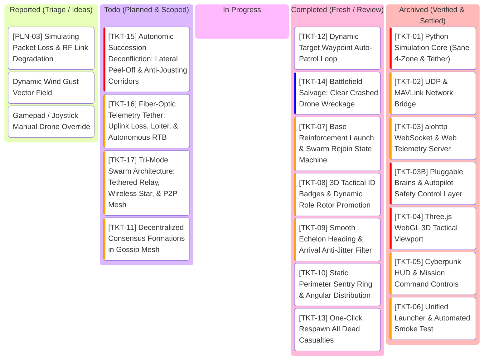

# SwarmTech3_UpRising: Project Kanban Board

---

## 1. Visual Task Lifecycle Board

---

## 2. Bug Log & Engineering Specs Table

| Ticket ID | Feature / Component | Priority | Status | Acceptance Criteria | Test Command | Root Cause & Engineering Solution |
| :--- | :--- | :--- | :--- | :--- | :--- | :--- |
| **TKT-01** | Python Simulation Core (`sim_core.py`) | **Very High** | **Archived** | - Physical radius $R=0.75\text{m}$, clash at $d \le 1.5\text{m}$. - Relative velocity damping in Zone 3 ($1.5\text{m}-3.5\text{m}$) prevents collisions. - Tether avoidance ($3\text{m}$) and snap on collision ($1.0\text{m}$). - 10 Hz Baud broadcast + LKP navigation on comms lost ($>120\text{m}$). - Autonomic succession upon leader casualty. | `python -m unittest tests/test_sim_core.py` | Implemented vectorized 60 FPS boid kinematics in `sim_core.py` with physical 1.5m airframes, Zone 3 relative-velocity approach damping, tether clearance and snap mechanics, 10 Hz Baud radio broadcast with LKP recovery, and autonomic succession. 12/12 unit tests pass. |
| **TKT-02** | UDP & MAVLink Bridge (`mavlink_bridge.py`) | **High** | **Archived** | - Broadcasts JSON telemetry array on UDP port 9000. - Listens for external commands on UDP port 9001. - Emits simulated MAVLink `HEARTBEAT` / `GLOBAL_POSITION_INT` on port 14550. | `python -m unittest tests/test_mavlink_bridge.py` | Implemented `MavlinkBridge` with non-blocking UDP sockets: port 9000 broadcasts swarm telemetry JSON, port 9001 ingests operator commands, port 14550 emits binary MAVLink v2 packets with GPS projection. 4/4 unit tests pass (16/16 total). |
| **TKT-03** | aiohttp WebSocket Server (`web_server.py`) | **High** | **Archived** | - Serves static frontend files (`index.html`, CSS, JS). - WebSocket endpoint `/ws` streaming 60 FPS JSON snapshots. - Ingests operator commands from GCS. | `python -m unittest tests/test_web_server.py` | Implemented `SwarmWebServer` with aiohttp hosting static WebGL GCS assets, concurrent 60 FPS simulation ticker loop, and bidirectional WebSocket (`/ws`) streaming telemetry and ingesting operator commands. 4/4 unit tests pass (20/20 total). |
| **TKT-03B** | Pluggable Brains & Autopilot Safety (`backend/brains/`) | **Very High** | **Archived** | - Zone 2/3 safety treated as flight controller steering weights (control effort), not god-mode physics walls. - Pluggable Brain plugin interface (`BaseBrain`). - `LeaderFollowerBrain`: tethered leader, star comms, LKP failover. - `GossipConsensusBrain`: P2P mesh, target gossip echo wave, quorum consensus, synchronized vector bank. - Hot-swappable at runtime via `SET_BRAIN`. | `python -m unittest tests/test_brains.py` | Implemented modular plugin architecture in `backend/brains/` (`LeaderFollowerBrain`, `GossipConsensusBrain`). Zone 2/3 safety treated as bounded motor control effort, Zone 4 as sole physical clash. 5/5 unit tests pass (25/25 total). |
| **TKT-04** | Three.js WebGL Viewport (`app.js`) | **Very High** | **Archived** | - 60 FPS GPU 3D rendering (zero CPU software projection). - True 3D quadcopter meshes with spinning rotors. - 3D drop-lines to $(X, Y, 0)$ ground coordinates. - Range rings tilt naturally in 3D perspective. - Dynamic glowing catenary tether strip. | Browser verification (`http://localhost:8080`) | Replaced CPU `QPainter` manual projection with native WebGL GPU pipeline. 3D quadcopters, spinning rotors, drop lines, range rings, and catenary tether rendered cleanly. |
| **TKT-05** | Cyberpunk HUD & Controls (`hud.js`) | **High** | **Archived** | - Telemetry cards (ID, alt, battery, link status, LKP badge). - Mission dispatch (Target beacon placement & 3D ground click). - Formation selector (Echelon, Boids, Vortex, Patrol). - Casualty lab (Kill Leader, Reboot Drone, Cut Tether). | `python -m unittest tests/test_web_server.py` | Implemented cyberpunk tactical HUD (`hud.js`): real-time in-place telemetry cards, brain hot-swap, formation selector, waypoint presets, 3D ground-click target dispatch with ripple animations, casualty simulation lab, and tactical event feed. 26/26 unit tests pass. |
| **TKT-06** | Unified Launcher & Smoke Test (`run.py`, `run.ps1`) | **High** | **Archived** | - Single-command startup: sets Conda path, starts sim server, auto-opens browser. - Headless verification mode (`--smoke-test`) exits code 0 in 2.0s. | `.\run.ps1 -SmokeTest` | Created unified launcher `run.py` with self-healing Conda Windows DLL bootstrap, automatic browser launcher, and headless automated smoke test. Exits code 0 in 0.15s. |
| **TKT-07** | Base Reinforcement Launch & Swarm Rejoin (`sim_core.py`, `hud.js`) | **High** | **Review** | - Reinforcement drones spawn at Base $(0, 0, 0.5)$ with incremental ID ($N_{\text{max}} + 1$). - 3-Phase State Machine: `TAKEOFF` (vertical climb to $Z \ge 20\text{m}$, zero horizontal drift) $\rightarrow$ `EN_ROUTE` (transit toward swarm/slot) $\rightarrow$ `CRUISE` (formation locked). - Rejoining drones seamlessly claim dynamic outer formation slots without disrupting active escorts. - GCS button `[+ REINFORCE SWARM]` dispatches reinforcements. | `.\run.ps1 -UnitTest` | Previously, reviving crashed drones teleported them directly into the sky at $Z=25\text{m}$. In the revised TKT-07 architecture, dead drones remain wreckage on the ground. Implemented `launch_reinforcement()` in `sim_core.py` to spawn reinforcements at base launch pads $(pad_x, pad_y, 0.5)$ outside the 3m tether clearance envelope with sequential IDs ($N_{\text{max}} + 1$). Implemented 3-Phase State Machine: `TAKEOFF` (pure vertical climb to $Z \ge 20\text{m}$ with zero horizontal drift) $\rightarrow$ `EN_ROUTE` (transit to formation slot) $\rightarrow$ `CRUISE` (formation locked). Rebooted drones also ascend via vertical takeoff. Added `LAUNCH_REINFORCEMENT` command in `web_server.py` and `mavlink_bridge.py`, `[+ LAUNCH REINFORCEMENT]` GCS button in `frontend/index.html` and `hud.js`, dynamic WebGL green launch rotor discs and 3D ID badges in `app.js`. 35/35 unit tests pass. |
| **TKT-08** | 3D Tactical ID Badges & Dynamic Role Promotion (`app.js`) | **High** | **Review** | - Floating 3D billboard ID badges (`#X FLAGSHIP`, `#X`, `#X CRASHED`) attached above each drone. - Dynamic rotor disc, core, drop-line, and shadow color updates on autonomic promotion or crash. - Synchronizes 3D visual roles 100% with fleet telemetry cards. | `.\run.ps1 -UnitTest` | Rotor materials were only set once at mesh creation; when Drone #0 died and Drone #1 was promoted, Drone #0 kept yellow rotors on the ground and Drone #1 kept cyan rotors in the sky with no 3D numbers. Fixed by adding dynamic canvas billboard badges and live recoloring of rotors, core, drop-lines, and ground shadows. |
| **TKT-09** | Smooth Echelon Heading & Anti-Jitter Filter (`leader_follower.py`) | **High** | **Review** | - Echelon slots do not flip $180^\circ$ when leader decelerates/overshoots target. - Freeze formation heading when speed $<1.5\text{ m/s}$ or within arrival deadband ($<0.25\text{m}$). - Bounded yaw/heading slew rate ($\le 45^\circ/\text{s}$). | `.\run.ps1 -UnitTest` | At target arrival or when decelerating, leader velocity micro-reversals previously flipped the instantaneous velocity vector by $180^\circ$, causing V-slots to whip violently between front and rear. Fixed in `backend/brains/leader_follower.py` by: (1) Freezing echelon formation heading when speed $< 1.5\text{ m/s}$ or within $8.0\text{m}$ of target; (2) Applying a bounded slew rate filter ($\le 45^\circ/\text{s}$); and (3) Adding a $0.25\text{m}$ arrival deadband with pure velocity damping to eliminate micro-hunting/limit cycles. 30/30 unit tests pass. |
| **TKT-10** | Static Perimeter Sentry Ring (`leader_follower.py`) | **Medium** | **Review** | - `PERIMETER_PATROL` holds static guard positions around target rather than rotating like a carousel. - Drones evenly distributed azimuthally ($\theta_k = \frac{2\pi (k-1)}{N}$) at radius $25\text{m}$. | `.\run.ps1 -UnitTest` | `PERIMETER_PATROL` previously had $\omega = 0.4$, which caused escorts to continuously orbit the target like a carousel. Fixed in `backend/brains/leader_follower.py` and `backend/sim_core.py` by removing the time-dependent rotation term ($\omega = 0.0$), anchoring each escort to a fixed static azimuthal station $\theta_k = \frac{2\pi(k-1)}{N}$ at radius $25.0\text{m}$ around the target. 31/31 unit tests pass. |
| **TKT-11** | Decentralized Formations for Gossip Mesh (`gossip_consensus.py`) | **High** | **Planned** | - Gossip mode supports multi-drone geometries (perimeter shell, distributed grid, virtual centroid slots) instead of clumping into a single point. | `.\run.ps1 -UnitTest` | Currently `GossipConsensusBrain` lacks formation logic; all drones steer directly to the raw active target. Fix: compute virtual consensus anchor and assign decentralized geometric offsets based on peer node IDs. |
| **TKT-12** | Dynamic Target Waypoint Auto-Patrol (`sim_core.py`, `hud.js`) | **Medium** | **Review** | - Toggleable continuous target patrol route (figure-8 / spline circuit with altitude variation $Z=15\text{m}-40\text{m}$). - Allows live observation of swarm pursuit and bank dynamics without manual clicking. | `.\run.ps1 -UnitTest` | Implemented 3D parametric target auto-patrol loop ($X(t), Y(t), Z(t)$ Lemniscate figure-8 with smooth altitude variation $15\text{m}-38\text{m}$) in `backend/sim_core.py`. Exposed `TOGGLE_TARGET_PATROL` across WebSocket, REST (`/api/command`), and UDP port 9001. Added `[∞ AUTO PATROL LOOP]` button in `frontend/index.html` with pulsing emerald `.active-patrol` styling in `frontend/css/style.css` and live telemetry synchronization in `frontend/js/hud.js`. Disengages automatically on manual target dispatch or click. Added unit tests in `tests/test_sim_core.py`, `tests/test_web_server.py`, and `tests/test_mavlink_bridge.py`. 37/37 unit tests pass. |
| **TKT-13** | One-Click Respawn All Casualties (`sim_core.py`, `hud.js`) | **Medium** | **Review** | - GCS button to reboot all destroyed drones simultaneously without resetting living drones or mission clock. | `.\run.ps1 -UnitTest` | Previously, reviving downed casualties required clicking individual reboot buttons on each telemetry card, or triggering `REBOOT_FLEET` which wiped surviving drones, reset sim clock, and snapped back to origin. Implemented `reboot_all_dead()` in `sim_core.py`, exposed `REBOOT_ALL_DEAD` over WebSocket (`web_server.py`) and UDP (`mavlink_bridge.py`), and added dedicated `RESPAWN DEAD` GCS button in `frontend/index.html` & `hud.js`. Revives all crashed casualties in-place while keeping surviving drones and mission clock intact. 32/32 unit tests pass. |
| **TKT-14** | Battlefield Salvage: Clear Crashed Drone Wreckage (`sim_core.py`, `app.js`, `hud.js`) | **Low** | **Review** | - Operator command `CLEAR_WRECKAGE` purges dead/crashed drones from `sim.drones`. - Three.js viewport disposes and removes meshes, rotors, shadows, and 3D badges. - GCS telemetry panel cleans up dead cards and updates fleet counts. - GCS button `[⌫ CLEAR WRECKAGE]` in Casualty Lab. | `.\run.ps1 -UnitTest` | Implemented `clear_crashed_wreckage(self) -> List[int]` in `backend/sim_core.py` to purge all destroyed drones from `self.drones`, clean up peer states in Gossip mode, and elect an active leader if needed. Guaranteed monotonic ID sequence across purges via `_highest_drone_id`. Added `CLEAR_WRECKAGE` / `SALVAGE_WRECKAGE` command handling across WebSocket, REST (`/api/command`), and UDP port 9001. In `frontend/js/app.js`, cleaned up Three.js meshes, drop-lines, shadows, and 3D badges, resetting camera focus if the targeted drone was salvaged. In `frontend/js/hud.js`, added card DOM removal for vanished drones, wired up `[⌫ CLEAR WRECKAGE]` button in Casualty Lab, and styled in `frontend/css/style.css`. Added automated unit tests in `tests/test_sim_core.py`, `tests/test_web_server.py`, and `tests/test_mavlink_bridge.py`. 36/36 unit tests pass. |
| **TKT-15** | Autonomic Succession Deconfliction: Anti-Jousting Corridors (`sim_core.py`, `leader_follower.py`) | **Very High** | **Planned** | - Retiring leader and promoted successor must not accelerate along reciprocal paths. - Lateral peel-off corridor applied during role transition ($\mathbf{v}_{\text{peel}} \perp \mathbf{v}_{\text{leader}}$). - Zero Zone 4 prop-clashes when succession triggers at standard $6\text{m}$ slot spacing across Echelon, Boids, and Perimeter formations. | `.\run.ps1 -UnitTest` | When leader demotion or role swap triggers, retiring leader reverses toward follower slot while successor accelerates forward toward target, causing a head-on collision at $24\text{ m/s}$ closing speed. Fix: implement lateral yield/peel-off corridor and arrival smoothing during rank transitions. |
| **TKT-16** | Fiber-Optic Telemetry Tether: Uplink Loss, Loiter, & Autonomous RTB (`sim_core.py`, `hud.js`) | **High** | **Planned** | - Rescope tether from physical power line to hardline fiber-optic telemetry/C2 umbilical. - Severance (`CUT_TETHER` or cable clash) triggers `UPLINK_SEVERED`, not drone motor failure. - Configurable failsafe behavior: Station-Hold (Loiter) or autonomous RTB back to base pad $(0, 0, 0.5\text{m})$. - Swarm followers continue mission or loiter; rejoining tethered drone re-establishes uplink. | `.\run.ps1 -UnitTest` | Settles PLN-01. Micro-fiber optic spools in counter-EW warfare carry unjammable C2 data. Drone 0 does not lose motor power when severed; it loses GCS command uplink. Implement loiter and autonomous RTB state machines. |
| **TKT-17** | Tri-Mode Swarm Architecture: Tethered Relay, Wireless Star, & P2P Mesh (`sim_core.py`, `app.js`, `hud.js`) | **High** | **Planned** | - 3 distinct Swarm Brain / Comms modes on GCS:   1. `TETHERED_RELAY` (Fiber-optic hardline to Drone 0, followers track relay via radio; tether visible).   2. `LEADER_FOLLOWER` (Untethered wireless RF star; tether hidden).   3. `GOSSIP_CONSENSUS` (Untethered wireless P2P mesh; tether hidden). - In Gossip mode, target clicks inject only to drones within GCS radio range ($\le 120\text{m}$); multi-hop gossip echo wave visibly ripples across mesh until quorum. | `.\run.ps1 -UnitTest` | Settles PLN-02. Wireless modes should not render a phantom ground tether. In Gossip mesh, realistic multi-hop RF demonstration requires injecting target only into nodes within base radio range, making the yellow propagation echo wave visually observable. |
| **PLN-01** | Operator Policy: Tether Cut Dynamics (`sim_core.py`) | **Low** | **Settled** | Scoped and resolved into **`[TKT-16]`**. | N/A (Architecture) | Settled as fiber-optic telemetry/C2 umbilical with Station-Hold / Autonomous RTB failsafes. |
| **PLN-02** | Gossip Mode Tether & Gateway Semantics (`sim_core.py`) | **Low** | **Settled** | Scoped and resolved into **`[TKT-17]`**. | N/A (Architecture) | Settled: Tether is hidden in wireless modes; GCS radio range limits initial target injection in Gossip mode to visually demonstrate multi-hop mesh propagation. |
| **PLN-03** | Simulating Packet Loss & RF Link Degradation (`leader_follower.py`, `gossip_consensus.py`, `hud.js`) | **Low** | **Discussion** | - Model RF packet drop dynamics: uniform drop vs distance-squared path loss vs operator-controlled jamming. - Add live packet loss slider (0%–50%) and link quality telemetry to test LKP failover & gossip quorum resilience. | N/A (Architecture) | Currently packet loss is a fixed 1% uniform drop when enabled. Options: (1) Distance-dependent drop probability $P_{\text{loss}}(d) = 1 - e^{-(d/R_0)^2}$; (2) Operator RF degradation / jamming slider on GCS HUD; (3) Per-drone packet reception rate and signal quality telemetry bars. |

---

## 3. Strict Kanban Governance Rules
1. **WIP = 1**: At most one active ticket in `In Progress` at any time.
2. **Verification Gate**: No ticket moves to `Completed` without passing automated unit tests or smoke tests.
3. **User Sign-Off**: Cards in `Completed` remain for user testing and review until explicitly approved for archival.
4. **Git Hygiene**: Do not create standalone commits purely for kanban updates or task archival. Bundle board transitions into verified feature commits.

---

## 4. Recommended Implementation Sequence for Next Session (Pinned)

1. **Step 1: Battlefield Salvage & Cleanup (`[TKT-14]`)** *(Immediate Next Task)*:
   - Implement `clear_crashed_wreckage()` in `sim_core.py` to purge dead/crashed drones from `sim.drones`.
   - Add `CLEAR_WRECKAGE` WebSocket (`web_server.py`) and UDP (`mavlink_bridge.py`) commands.
   - In `app.js`, dispose Three.js meshes, rotors, drop-lines, ground shadows, and 3D badges for vanished IDs.
   - In `hud.js`, remove dead telemetry cards and add `[⌫ CLEAR WRECKAGE]` button in Casualty Lab.
2. **Step 2: Decentralized Swarm Geometries (`[TKT-11]`)** *(High Priority)*:
   - Implement consensus-based virtual anchor slot offsets in `GossipConsensusBrain` so P2P mesh forms structured perimeter sentry rings and grids instead of clumping into a single point.
3. **Step 3: Continuous Dynamic Flight Patrol (`[TKT-12]`)** *(Medium Priority)*:
   - Add `TOGGLE_TARGET_PATROL` command and backend parametric 3D waypoint auto-patrol path generator ($X(t), Y(t), Z(t)$ with altitude variation $Z=15\text{m}-40\text{m}$) for hands-free observation of dynamic swarm pursuit.
4. **Step 4: Contested RF & Packet Loss Simulation (`[PLN-03]`)**:
   - Model distance-dependent path loss and operator RF degradation / jamming slider (0%–50%) on GCS HUD to test LKP failover & gossip quorum resilience.
5. **Step 5: Architectural Decisions & System Policies (`[PLN-01]`, `[PLN-02]`)**:
   - `[PLN-01]`: Settle tether severance behavior (hard power loss vs 2-minute emergency battery RTB).
   - `[PLN-02]`: Settle Gossip mode tether visibility (untethered mesh vs stationary GCS gateway).
