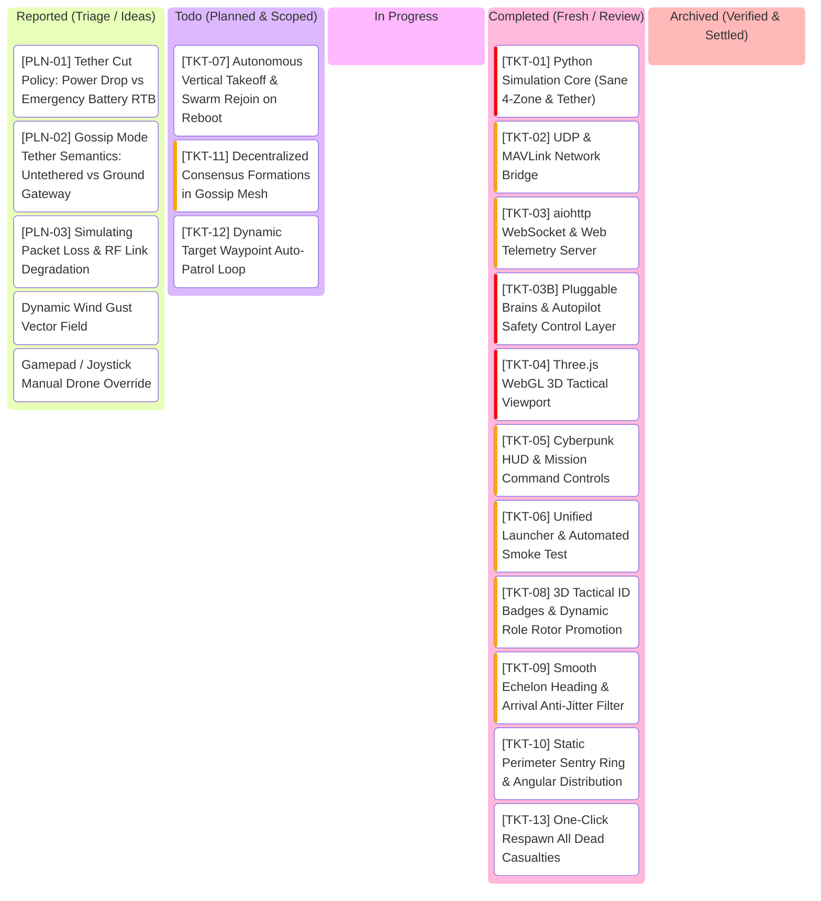

# SwarmTech3_UpRising: Project Kanban Board

---

## 1. Visual Task Lifecycle Board

---

## 2. Bug Log & Engineering Specs Table

| Ticket ID | Feature / Component | Priority | Status | Acceptance Criteria | Test Command | Root Cause & Engineering Solution |
| :--- | :--- | :--- | :--- | :--- | :--- | :--- |
| **TKT-01** | Python Simulation Core (`sim_core.py`) | **Very High** | **Review** | - Physical radius $R=0.75\text{m}$, clash at $d \le 1.5\text{m}$. - Relative velocity damping in Zone 3 ($1.5\text{m}-3.5\text{m}$) prevents collisions. - Tether avoidance ($3\text{m}$) and snap on collision ($1.0\text{m}$). - 10 Hz Baud broadcast + LKP navigation on comms lost ($>120\text{m}$). - Autonomic succession upon leader casualty. | `python -m unittest tests/test_sim_core.py` | Implemented vectorized 60 FPS boid kinematics in `sim_core.py` with physical 1.5m airframes, Zone 3 relative-velocity approach damping, tether clearance and snap mechanics, 10 Hz Baud radio broadcast with LKP recovery, and autonomic succession. 12/12 unit tests pass. |
| **TKT-02** | UDP & MAVLink Bridge (`mavlink_bridge.py`) | **High** | **Review** | - Broadcasts JSON telemetry array on UDP port 9000. - Listens for external commands on UDP port 9001. - Emits simulated MAVLink `HEARTBEAT` / `GLOBAL_POSITION_INT` on port 14550. | `python -m unittest tests/test_mavlink_bridge.py` | Implemented `MavlinkBridge` with non-blocking UDP sockets: port 9000 broadcasts swarm telemetry JSON, port 9001 ingests operator commands, port 14550 emits binary MAVLink v2 packets with GPS projection. 4/4 unit tests pass (16/16 total). |
| **TKT-03** | aiohttp WebSocket Server (`web_server.py`) | **High** | **Review** | - Serves static frontend files (`index.html`, CSS, JS). - WebSocket endpoint `/ws` streaming 60 FPS JSON snapshots. - Ingests operator commands from GCS. | `python -m unittest tests/test_web_server.py` | Implemented `SwarmWebServer` with aiohttp hosting static WebGL GCS assets, concurrent 60 FPS simulation ticker loop, and bidirectional WebSocket (`/ws`) streaming telemetry and ingesting operator commands. 4/4 unit tests pass (20/20 total). |
| **TKT-03B** | Pluggable Brains & Autopilot Safety (`backend/brains/`) | **Very High** | **Review** | - Zone 2/3 safety treated as flight controller steering weights (control effort), not god-mode physics walls. - Pluggable Brain plugin interface (`BaseBrain`). - `LeaderFollowerBrain`: tethered leader, star comms, LKP failover. - `GossipConsensusBrain`: P2P mesh, target gossip echo wave, quorum consensus, synchronized vector bank. - Hot-swappable at runtime via `SET_BRAIN`. | `python -m unittest tests/test_brains.py` | Implemented modular plugin architecture in `backend/brains/` (`LeaderFollowerBrain`, `GossipConsensusBrain`). Zone 2/3 safety treated as bounded motor control effort, Zone 4 as sole physical clash. 5/5 unit tests pass (25/25 total). |
| **TKT-04** | Three.js WebGL Viewport (`app.js`) | **Very High** | **Review** | - 60 FPS GPU 3D rendering (zero CPU software projection). - True 3D quadcopter meshes with spinning rotors. - 3D drop-lines to $(X, Y, 0)$ ground coordinates. - Range rings tilt naturally in 3D perspective. - Dynamic glowing catenary tether strip. | Browser verification (`http://localhost:8080`) | Replaced CPU `QPainter` manual projection with native WebGL GPU pipeline. 3D quadcopters, spinning rotors, drop lines, range rings, and catenary tether rendered cleanly. |
| **TKT-05** | Cyberpunk HUD & Controls (`hud.js`) | **High** | **Review** | - Telemetry cards (ID, alt, battery, link status, LKP badge). - Mission dispatch (Target beacon placement & 3D ground click). - Formation selector (Echelon, Boids, Vortex, Patrol). - Casualty lab (Kill Leader, Reboot Drone, Cut Tether). | `python -m unittest tests/test_web_server.py` | Implemented cyberpunk tactical HUD (`hud.js`): real-time in-place telemetry cards, brain hot-swap, formation selector, waypoint presets, 3D ground-click target dispatch with ripple animations, casualty simulation lab, and tactical event feed. 26/26 unit tests pass. |
| **TKT-06** | Unified Launcher & Smoke Test (`run.py`, `run.ps1`) | **High** | **Review** | - Single-command startup: sets Conda path, starts sim server, auto-opens browser. - Headless verification mode (`--smoke-test`) exits code 0 in 2.0s. | `.\run.ps1 -SmokeTest` | Created unified launcher `run.py` with self-healing Conda Windows DLL bootstrap, automatic browser launcher, and headless automated smoke test. Exits code 0 in 0.15s. |
| **TKT-07** | Autonomous Takeoff on Reboot (`sim_core.py`) | **Medium** | **Planned** | - Rebooted crashed drones ascend vertically to safe transition altitude before steering into formation. - Eliminates horizontal low-altitude drag/collision across terrain. | `.\run.ps1 -UnitTest` | Pending implementation. When a drone is rebooted, enforce vertical takeoff state machine (`TAKEOFF` -> `CRUISE`) before boid flocking forces are applied. |
| **TKT-08** | 3D Tactical ID Badges & Dynamic Role Promotion (`app.js`) | **High** | **Review** | - Floating 3D billboard ID badges (`#X FLAGSHIP`, `#X`, `#X CRASHED`) attached above each drone. - Dynamic rotor disc, core, drop-line, and shadow color updates on autonomic promotion or crash. - Synchronizes 3D visual roles 100% with fleet telemetry cards. | `.\run.ps1 -UnitTest` | Rotor materials were only set once at mesh creation; when Drone #0 died and Drone #1 was promoted, Drone #0 kept yellow rotors on the ground and Drone #1 kept cyan rotors in the sky with no 3D numbers. Fixed by adding dynamic canvas billboard badges and live recoloring of rotors, core, drop-lines, and ground shadows. |
| **TKT-09** | Smooth Echelon Heading & Anti-Jitter Filter (`leader_follower.py`) | **High** | **Review** | - Echelon slots do not flip $180^\circ$ when leader decelerates/overshoots target. - Freeze formation heading when speed $<1.5\text{ m/s}$ or within arrival deadband ($<0.25\text{m}$). - Bounded yaw/heading slew rate ($\le 45^\circ/\text{s}$). | `.\run.ps1 -UnitTest` | At target arrival or when decelerating, leader velocity micro-reversals previously flipped the instantaneous velocity vector by $180^\circ$, causing V-slots to whip violently between front and rear. Fixed in `backend/brains/leader_follower.py` by: (1) Freezing echelon formation heading when speed $< 1.5\text{ m/s}$ or within $8.0\text{m}$ of target; (2) Applying a bounded slew rate filter ($\le 45^\circ/\text{s}$); and (3) Adding a $0.25\text{m}$ arrival deadband with pure velocity damping to eliminate micro-hunting/limit cycles. 30/30 unit tests pass. |
| **TKT-10** | Static Perimeter Sentry Ring (`leader_follower.py`) | **Medium** | **Review** | - `PERIMETER_PATROL` holds static guard positions around target rather than rotating like a carousel. - Drones evenly distributed azimuthally ($\theta_k = \frac{2\pi (k-1)}{N}$) at radius $25\text{m}$. | `.\run.ps1 -UnitTest` | `PERIMETER_PATROL` previously had $\omega = 0.4$, which caused escorts to continuously orbit the target like a carousel. Fixed in `backend/brains/leader_follower.py` and `backend/sim_core.py` by removing the time-dependent rotation term ($\omega = 0.0$), anchoring each escort to a fixed static azimuthal station $\theta_k = \frac{2\pi(k-1)}{N}$ at radius $25.0\text{m}$ around the target. 31/31 unit tests pass. |
| **TKT-11** | Decentralized Formations for Gossip Mesh (`gossip_consensus.py`) | **High** | **Planned** | - Gossip mode supports multi-drone geometries (perimeter shell, distributed grid, virtual centroid slots) instead of clumping into a single point. | `.\run.ps1 -UnitTest` | Currently `GossipConsensusBrain` lacks formation logic; all drones steer directly to the raw active target. Fix: compute virtual consensus anchor and assign decentralized geometric offsets based on peer node IDs. |
| **TKT-12** | Dynamic Target Waypoint Auto-Patrol (`sim_core.py`, `hud.js`) | **Medium** | **Planned** | - Toggleable continuous target patrol route (figure-8 / spline circuit with altitude variation $Z=15\text{m}-40\text{m}$). - Allows live observation of swarm pursuit and bank dynamics without manual clicking. | Browser verification | Add `TOGGLE_TARGET_PATROL` command and backend parametric path generator ($X(t), Y(t), Z(t)$) with operator speed slider. |
| **TKT-13** | One-Click Respawn All Casualties (`sim_core.py`, `hud.js`) | **Medium** | **Review** | - GCS button to reboot all destroyed drones simultaneously without resetting living drones or mission clock. | `.\run.ps1 -UnitTest` | Previously, reviving downed casualties required clicking individual reboot buttons on each telemetry card, or triggering `REBOOT_FLEET` which wiped surviving drones, reset sim clock, and snapped back to origin. Implemented `reboot_all_dead()` in `sim_core.py`, exposed `REBOOT_ALL_DEAD` over WebSocket (`web_server.py`) and UDP (`mavlink_bridge.py`), and added dedicated `RESPAWN DEAD` GCS button in `frontend/index.html` & `hud.js`. Revives all crashed casualties in-place while keeping surviving drones and mission clock intact. 32/32 unit tests pass. |
| **PLN-01** | Operator Policy: Tether Cut Dynamics (`sim_core.py`) | **Low** | **Discussion** | - Decide whether tether severance = immediate total power loss (ballistic crash) or loss of wired link + emergency battery RTB. | N/A (Architecture) | Commercial tethered drones carry a 2-minute emergency LiPo buffer. If cut: Option A (current) cuts motor power immediately; Option B triggers emergency autonomic RTB / controlled landing while handing swarm command to an untethered escort. |
| **PLN-02** | Gossip Mode Tether & Gateway Semantics (`sim_core.py`) | **Low** | **Discussion** | - Clarify whether Gossip mode should hide the tether entirely (pure untethered mesh) or treat the GCS mast as a stationary RF node. | N/A (Architecture) | In pure decentralized gossip, no single drone is tethered to ground. Options: (1) Automatically disconnect/hide tether when in Gossip mode; (2) Model GCS mast as stationary mesh anchor emitting mission updates. |
| **PLN-03** | Simulating Packet Loss & RF Link Degradation (`leader_follower.py`, `gossip_consensus.py`, `hud.js`) | **Low** | **Discussion** | - Model RF packet drop dynamics: uniform drop vs distance-squared path loss vs operator-controlled jamming. - Add live packet loss slider (0%–50%) and link quality telemetry to test LKP failover & gossip quorum resilience. | N/A (Architecture) | Currently packet loss is a fixed 1% uniform drop when enabled. Options: (1) Distance-dependent drop probability $P_{\text{loss}}(d) = 1 - e^{-(d/R_0)^2}$; (2) Operator RF degradation / jamming slider on GCS HUD; (3) Per-drone packet reception rate and signal quality telemetry bars. |

---

## 3. Strict Kanban Governance Rules
1. **WIP = 1**: At most one active ticket in `In Progress` at any time.
2. **Verification Gate**: No ticket moves to `Completed` without passing automated unit tests or smoke tests.
3. **User Sign-Off**: Cards in `Completed` remain for user testing and review until explicitly approved for archival.

---

## 4. Recommended Implementation Sequence for Next Session (Pinned)

1. **Step 1: Stabilize Formation Kinematics (`[TKT-09]` + `[TKT-10]`)**:
   - `[TKT-09]`: Freeze Echelon heading at low speeds ($<1.5\text{ m/s}$) + bounded slew filter ($\le 45^\circ/\text{s}$) + $0.25\text{m}$ arrival deadband. *Eliminates escort whipping on target arrival.*
   - `[TKT-10]`: Set $\omega = 0.0$ for `PERIMETER_PATROL` with static azimuthal distribution. *Converts carousel into static sentry ring.*
2. **Step 2: Operator Ergonomics & Casualty Recovery (`[TKT-13]` + `[TKT-07]`)**:
   - `[TKT-13]`: One-click `RESPAWN ALL CASUALTIES` button to reboot all dead drones in-place.
   - `[TKT-07]`: Vertical climb state machine on drone reboot ($Z \ge 15\text{m}$) before boid flocking forces engage.
3. **Step 3: Decentralized Swarm Geometries (`[TKT-11]`)**:
   - `[TKT-11]`: Implement virtual-anchor consensus formations for Gossip mesh (distributed sentry ring / grid).
4. **Step 4: Dynamic Flight Demonstration (`[TKT-12]`)**:
   - `[TKT-12]`: Continuous 3D auto-patrol circuit for dynamic swarm pursuit.
5. **Step 5: Architectural Decisions (`[PLN-01]`, `[PLN-02]`, `[PLN-03]`)**:
   - `[PLN-01]`: Tether severance policy (ballistic power cut vs 2-minute emergency battery RTB).
   - `[PLN-02]`: Gossip mode tether visibility (untethered mesh vs GCS gateway).
   - `[PLN-03]`: Packet loss & RF degradation model (path loss vs operator jamming slider vs link metrics).
