# AlitheiaHive_v3-Uprising: Project Kanban Board

> **Tactical GCS Workflow & Task Lifecycle** | **Palette: Dark Navy (#061019) & Neon Cyan (#00F0FF)**  
> *50/50 Architecture: Pure Python Kinematics & GPU-Native Three.js Rendering across 4 Airgaps*

---

## 1. Visual Task Lifecycle Board

```mermaid
%%{init: {
  'theme': 'base',
  'themeVariables': {
    'primaryColor': '#0d2235',
    'primaryTextColor': '#d4f4ff',
    'primaryBorderColor': '#00f0ff',
    'lineColor': '#00f0ff',
    'background': '#061019',
    'mainBkg': '#0a1926',
    'secondaryColor': '#081420',
    'secondaryTextColor': '#5a7e96',
    'secondaryBorderColor': '#134e6f',
    'tertiaryColor': '#0e263d',
    'tertiaryTextColor': '#00ffaa',
    'tertiaryBorderColor': '#00ffaa',
    'clusterBkg': '#081420',
    'clusterBorder': '#134e6f',
    'fontFamily': "'JetBrains Mono', 'Courier New', monospace"
  }
}}%%
kanban
  reported["Reported (Triage / Ideas: All Activated)"]
  frozen["Frozen (Parked Gimmicks)"]
    tkt20["Airframe Inertia & Actuator Lag"]@{ ticket: '[TKT-20]', priority: 'Very Low' }
    tkt21["Dynamic Power & LiPo Curves"]@{ ticket: '[TKT-21]', priority: 'Very Low' }
    tkt24["Dynamic Wind Gust Vector Field"]@{ ticket: '[TKT-24]', priority: 'Very Low' }
    tkt44["High-Scale Multi-Tier Swarms"]@{ ticket: '[TKT-44]', priority: 'Very Low' }
  backlog["Backlog (Staged / Non-Essential)"]
    tkt51["Physical Courier / Rescue Mule"]@{ ticket: '[TKT-51]', priority: 'Medium' }
    tkt47["Declarative Deployment Scenarios"]@{ ticket: '[TKT-47]', priority: 'Medium' }
    tkt22["Manual RC Joystick & Gamepad"]@{ ticket: '[TKT-22]', priority: 'Medium' }
    tkt36["Interactive 3D Route Planner"]@{ ticket: '[TKT-36]', priority: 'Low' }
    tkt45["MAVLink v2 HMAC Signing & EW"]@{ ticket: '[TKT-45]', priority: 'Medium' }
    tkt39["Standalone OBC Socket Daemon"]@{ ticket: '[TKT-39]', priority: 'Medium' }
    tkt37["SITL Provider (ArduPilot / PX4)"]@{ ticket: '[TKT-37]', priority: 'Low' }
    tkt38["Hardware Provider (Radio Modem)"]@{ ticket: '[TKT-38]', priority: 'Very Low' }
  todo["Todo (Active Pipeline)"]
  in_progress["In Progress (WIP = 1)"]
  completed["Completed (Fresh / Review)"]
    tkt43["Dynamic Hungarian Formation Inversion"]@{ ticket: '[TKT-43]', priority: 'High' }
    tkt52["Tactical GNSS Denial & Dead-Reckoning"]@{ ticket: '[TKT-52]', priority: 'High' }
    tkt42["Batched ATC Pad Recovery"]@{ ticket: '[TKT-42]', priority: 'High' }
    tkt41["Cold-Start Pad Scramble"]@{ ticket: '[TKT-41]', priority: 'High' }
    tkt48["Airframe Hardware Identity Registry"]@{ ticket: '[TKT-48]', priority: 'High' }
    tkt50["Dynamic In-Flight Swarm Enrollment"]@{ ticket: '[TKT-50]', priority: 'Medium' }
    tkt49["Asymmetric RF Link Budget (Yip-Back)"]@{ ticket: '[TKT-49]', priority: 'High' }
    fix07["MAVLink Multi-Vehicle Telemetry"]@{ ticket: '[FIX-07]', priority: 'Very High' }
    fix08["Coordinated ATC Landing Station-Keeping"]@{ ticket: '[FIX-08]', priority: 'High' }
    fix06["MAVLink Multi-Vehicle Responders"]@{ ticket: '[FIX-06]', priority: 'Very High' }
    tkt23["Natural Reynolds 3D Flocking"]@{ ticket: '[TKT-23]', priority: 'High' }
    fix05["Comms Horizon Telemetry Gate"]@{ ticket: '[FIX-05]', priority: 'Very High' }
  archived["Archived (Settled in tasks/archived/)"]
    arch_m1_6["Core 50/50 Architecture (TKT-01..06)"]@{ ticket: '[M1-M6]' }
    arch_m7_10_13["Formations & Badges (TKT-07..10, 13)"]@{ ticket: '[M7-M10,13]' }
    arch_m11_19["Tether, Tri-Mode RF & RTB (TKT-11..19)"]@{ ticket: '[TKT-11-19]' }
    arch_m25_29["Decoupling, Dual Targets & Routes (TKT-25..29)"]@{ ticket: '[TKT-25-29]' }
    arch_m33_34["3-Bubble Decoupling (TKT-33, 34)"]@{ ticket: '[TKT-33-34]' }
    arch_m30_46["MAVLink, Viewports & Guards (TKT-30..46)"]@{ ticket: '[M30-46,FIX03-04]' }
```

---

## 2. Active Engineering Task Index

> *Detailed blueprints, acceptance criteria, and root cause notes live in isolated modular documents:*
> * Active / Completed specs: [`tasks/`](tasks/)
> * Backlog candidates: [`tasks/backlog/`](tasks/backlog/)
> * Settled milestone archives: [`tasks/archived/`](tasks/archived/)

| Ticket ID | Grade | Title | Operational Inspiration | Spec Document |
| :--- | :--- | :--- | :--- | :--- |
| **TKT-52** | 🚀 Feature | Tactical GNSS Denial & Dead-Reckoning RTB | Real EW GPS spoofing in contested airspace | [`tasks/TKT-52_tactical_gnss_denial.md`](tasks/TKT-52_tactical_gnss_denial.md) |
| **TKT-43** | 🛠️ Improvement | Dynamic Hungarian Formation Inversion | Eliminates 80m cross-flight drag races on U-turns | [`tasks/TKT-43_dynamic_hungarian_inversion.md`](tasks/TKT-43_dynamic_hungarian_inversion.md) |
| **TKT-42** | 🛠️ Improvement | Batched ATC Pad Recovery & Downwash Clearance | Large fleets landing in dirt outside pad capacity | [`tasks/TKT-42_batched_atc_recovery.md`](tasks/TKT-42_batched_atc_recovery.md) |
| **TKT-41** | 🛠️ Improvement | Cold-Start Pad Scramble & Sequenced Climb-Out | Airframes initializing mid-air without spool up | [`tasks/TKT-41_cold_start_pad_scramble.md`](tasks/TKT-41_cold_start_pad_scramble.md) |
| **TKT-48** | 🛠️ Improvement | Airframe Hardware Identity & Fleet Registry | Fleets using transient zero-indexed integers | [`tasks/TKT-48_airframe_hardware_identity.md`](tasks/TKT-48_airframe_hardware_identity.md) |
| **TKT-50** | 🚀 Feature | Dynamic In-Flight Swarm Enrollment & Rejoin | Reinforcements jumping directly to phantom slots | [`tasks/TKT-50_dynamic_in_flight_enrollment.md`](tasks/TKT-50_dynamic_in_flight_enrollment.md) |
| **TKT-49** | 🚀 Feature | Asymmetric RF Link Budget ("Yip-Back") | GCS mast vs micro-drone TX asymmetry | [`tasks/TKT-49_asymmetric_rf_link_budget.md`](tasks/TKT-49_asymmetric_rf_link_budget.md) |
| **FIX-07** | 🛠️ Improvement | MAVLink Multi-Vehicle Telemetry & GPS Track | Mission Planner black North track & orange lines | [`tasks/FIX-07_mavlink_multi_vehicle_telemetry.md`](tasks/FIX-07_mavlink_multi_vehicle_telemetry.md) |
| **FIX-08** | 🛠️ Improvement | Coordinated ATC Landing Station-Keeping | Repulsion scattering hovering drones to map edge | [`tasks/FIX-08_coordinated_atc_landing.md`](tasks/FIX-08_coordinated_atc_landing.md) |
| **FIX-06** | 🛠️ Improvement | MAVLink Multi-Vehicle Params & Responders | Mission Planner hung on vehicle 2 param list | [`tasks/FIX-06_mavlink_multi_vehicle_params.md`](tasks/FIX-06_mavlink_multi_vehicle_params.md) |
| **TKT-23** | 🚀 Feature | Natural Boids Flocking (True Reynolds 3D) | Cartesian grid world offsets preventing organic turns | [`tasks/TKT-23_natural_boids_flocking.md`](tasks/TKT-23_natural_boids_flocking.md) |
| **FIX-05** | 🛠️ Improvement | Comms Horizon Telemetry Gate & Lost-Link | GCS receiving omniscient coordinates past radio horizon | [`tasks/FIX-05_comms_horizon_telemetry_gate.md`](tasks/FIX-05_comms_horizon_telemetry_gate.md) |
| **TKT-51** | 🚀 Feature | Physical Courier / Search-and-Recall Mule | Fragile daisy chains dropping on single node loss | [`tasks/backlog/TKT-51_physical_courier_rescue.md`](tasks/backlog/TKT-51_physical_courier_rescue.md) |
| **TKT-47** | 🛠️ Improvement | Declarative Field Deployment Scenarios | Ground components clumped at identical (0,0,0) | [`tasks/backlog/TKT-47_declarative_deployment_scenarios.md`](tasks/backlog/TKT-47_declarative_deployment_scenarios.md) |
| **TKT-22** | 🚀 Feature | Manual RC Joystick & Gamepad Override | Operators lacking pilot stick controls | [`tasks/backlog/TKT-22_manual_rc_joystick.md`](tasks/backlog/TKT-22_manual_rc_joystick.md) |
| **TKT-36** | 🚀 Feature | Interactive 3D Route Planner & Geofence | Lacking custom in-viewport route drawing tools | [`tasks/backlog/TKT-36_3d_route_planner.md`](tasks/backlog/TKT-36_3d_route_planner.md) |
| **TKT-45** | 🚀 Feature | Cryptographic Comms Guard (HMAC Signing) | Unauthenticated packets allowing rogue SDR injection | [`tasks/backlog/TKT-45_cryptographic_comms_guard.md`](tasks/backlog/TKT-45_cryptographic_comms_guard.md) |
| **TKT-39** | 🛠️ Improvement | Standalone Drone OBC Network Daemon | OBC firmware tied to top-layer process | [`tasks/backlog/TKT-39_standalone_obc_daemon.md`](tasks/backlog/TKT-39_standalone_obc_daemon.md) |
| **TKT-37** | 🛠️ Improvement | SITL Target Provider (ArduPilot / PX4) | Need external autopilot verification without changing GCS | [`tasks/backlog/TKT-37_sitl_execution_provider.md`](tasks/backlog/TKT-37_sitl_execution_provider.md) |
| **TKT-38** | 🛠️ Improvement | Hardware Target Provider (Radio Modem Bridge) | Preparing core for field testing with real airframes | [`tasks/backlog/TKT-38_hardware_execution_provider.md`](tasks/backlog/TKT-38_hardware_execution_provider.md) |
| **TKT-20** | 🎭 Gimmick | Airframe Inertia & Actuator Dynamics | Point-mass kinematics yielding instant vector jumps | [`tasks/backlog/TKT-20_airframe_inertia.md`](tasks/backlog/TKT-20_airframe_inertia.md) |
| **TKT-21** | 🎭 Gimmick | Dynamic Power Envelope (LiPo Curves) | Static 100% telemetry display without power curves | [`tasks/backlog/TKT-21_dynamic_power_envelope.md`](tasks/backlog/TKT-21_dynamic_power_envelope.md) |
| **TKT-24** | 🎭 Gimmick | Dynamic Wind Gust Vector Field | Airframe operating in ideal dead-calm air | [`tasks/backlog/TKT-24_dynamic_wind_gust.md`](tasks/backlog/TKT-24_dynamic_wind_gust.md) |
| **TKT-44** | 🎭 Gimmick | High-Scale Multi-Tier Swarm Formations | Formations stretching beyond radio range at large counts | [`tasks/backlog/TKT-44_high_scale_formations.md`](tasks/backlog/TKT-44_high_scale_formations.md) |

---

## 3. Strict Kanban Governance Rules

1. **WIP = 1**: At most one active ticket in `In Progress` at any time.
2. **1-Card-1-Doc Scope**: All acceptance criteria, test commands, and architectural notes live in `tasks/`. `kanban.md` remains a lightweight index HUD.
3. **Verification Gate**: A code ticket moves to `Completed` only when its targeted test module passes. Non-code changes require zero tests.
4. **User Sign-Off**: Cards in `Completed` remain for user testing and review until explicitly approved for archival into `tasks/archived/`.
